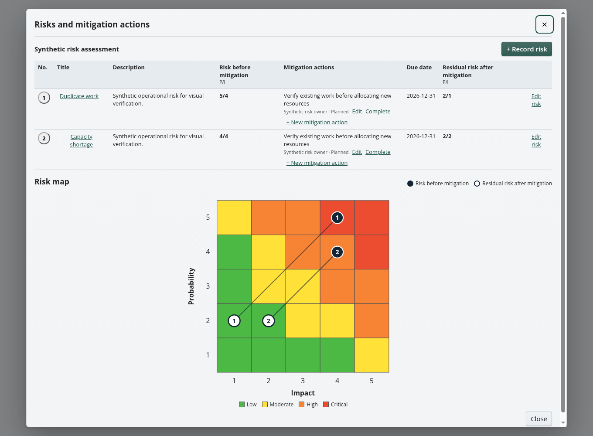

<p align="center">
  
</p>

<h1 align="center">Fylkren</h1>

<p align="center"><strong>Self-hosted, multilingual and AI-assisted operational task and mission management.</strong></p>

<p align="center">
  <code>VERSION 1.0.0</code> · <code>SELF-HOSTED</code> · <code>19 LANGUAGES</code> · <code>OPTIONAL AI</code> · <code>AIR-GAPPED READY</code>
</p>

<p align="center">
  <a href="https://mfuryto.github.io/fylkren/"><strong>Live demo</strong></a> ·
  <a href="#why-fylkren">Why Fylkren</a> ·
  <a href="#capabilities">Capabilities</a> ·
  <a href="#multilingual-and-ai-assisted">Languages and AI</a> ·
  <a href="#community-and-enterprise">Editions</a> ·
  <a href="#deployment">Deployment</a> ·
  <a href="docs/README.md">Documentation</a>
</p>

Fylkren gives organizations one secure operational chain for receiving,
assessing, planning, delegating, executing and reporting formal assignments.
It combines operational task management, mission management, risk management,
continuous learning and decision support in a Windows-familiar web interface.
Organizations retain their own data, identity, AI provider and infrastructure.

| **Direct the work** | **Retain local control** | **Improve the next operation** |
|:---|:---|:---|
| Route tasks, requests and decisions through the right level | Keep each site, role and work level within its authorization boundary | Preserve execution history, approvals, audit events and final reports |
| Delegate without taking over subordinate processing | Run locally, offline or in an isolated network | Turn risks, outcomes and internal learning into structured follow-up |

Explore the read-only [Fylkren demo](https://mfuryto.github.io/fylkren/) with
synthetic data, or go directly to the [user manual](docs/administration/USER_MANUAL.md),
[installation guide](docs/operations/INSTALLATION_AND_UPGRADES.md) or
[security policy](SECURITY.md).

## Why Fylkren

Many tools can store tasks. Fylkren is built to preserve the **command,
responsibility and reporting chain** around operational work.

- **Clear ownership** — each responsible level processes and reports its own
  part of an assignment.
- **Controlled delegation** — leaders can delegate and receive results without
  gaining automatic edit access to subordinate casework.
- **Real organizational boundaries** — sites remain separate administration
  and authorization domains, even when arranged in a hierarchy.
- **Traceability by default** — decisions, status changes, approvals and final
  reports remain understandable over time.
- **Offline independence** — core operation, authentication, documentation and
  licensing do not require a vendor cloud or continuous Internet access.
- **Multilingual operation** — 19 complete interface locales ship with the
  product and remain available on isolated networks.
- **Controlled AI assistance** — Enterprise can connect an approved local or
  hosted OpenAI-compatible provider and enable individual functions per Site.
- **One product, not two forks** — Community and Enterprise use the same
  database, containers, schema, migrations and upgrade path.

## The operational chain

```text
Task or request
      │
      ▼
Assessment ──► optional planning ──► execution ──► final report
      │                 │                 │               │
      └──── priority ───┴── delegation ───┴── status ─────┴──► learning ──►
```

Learning is a continuous operational process. Practices worth repeating and
improvements feed back into the next assessment, plan and execution. Closing a
task or a learning point does not end that cycle. Internal learning stays at its
own work level, separate from the final report sent upwards. See the
[learning guide](docs/administration/LEARNING.md).

New work follows the current organization. Work already in progress retains its
original routing and reporting path, even if sites or units are reorganized.
Cross-site requests expose the official response—not the receiving site's
internal processing.

## Capabilities

| Area | What Fylkren provides |
| --- | --- |
| **Tasks and requests** | Registration, permanent searchable task references, receipt, assessment, priority, deadlines, hold, rejection, reopening, cancellation, internal delegation and cross-site requests |
| **Planning and execution** | Optional planning, reusable workflows, step templates, timelines, rich text, decisions, dependencies, risks, mitigations and external follow-up |
| **Organization and access** | Independent and hierarchical sites, internal units, personnel, local roles, work-level permissions and server-enforced authorization |
| **Reports and records** | Level-owned final reports, approval versions, searchable archives, permanent request responses and print/PDF presentation |
| **Continuous learning** | Internal numbered observations linked to assignments, priorities, discussion, action plans, deadlines, accountable treatment and searchable outcomes |
| **Identity** | Local accounts, password policy, recovery, TOTP MFA, WebAuthn/passkeys, GUI-managed Enterprise AD/LDAP/OIDC/SAML, exact provider-bound links and automatic directory deprovisioning |
| **Administration** | Platform and site administration, customer-defined classifications, appearance, notifications, audit, health and technical status |
| **Integration** | Versioned administration/report APIs, bounded Enterprise AI assistance, signed webhooks, portable customer-data export and trusted Fylkren-to-Fylkren federation |
| **Deployment** | Docker Compose, PostgreSQL, persistent cryptographic keys, offline operation, backup/restore and documented upgrades |

## Multilingual and AI-assisted

Fylkren is multilingual by design. It includes 19 complete interface locales:
English (United States and United Kingdom), Norwegian Bokmal, Swedish, Danish,
Finnish, German, French, Polish, Spanish, Italian, Ukrainian, Dutch, Portuguese,
Czech, Romanian, Estonian, Latvian and Lithuanian. Language resources are
bundled, so changing language never depends on an external translation service.

Enterprise AI assistance is optional, centrally controlled and provider
independent. An installation can use an approved cloud service or a local
OpenAI-compatible model inside the customer's own network. Administrators can
enable AI per Site and per function. Fylkren uses it to help users:

- summarize and quality-check an assignment;
- generate editable planning suggestions from the active workflow template;
- propose risks and mitigations for human assessment;
- prepare editable decision-support drafts;
- group and prioritize internal learning points; and
- ask bounded questions about the current assignment.

AI output is presented as assistance or a draft. The responsible user reviews
and confirms the result before it becomes operational data. Imported primary
documents can provide structured AI context while the original document link
remains the user's authoritative reference. See the
[AI architecture and security boundaries](docs/architecture/AI_ASSISTANCE.md).

### The workspace

These screenshots show the actual interface with fictional example data.

| Operational overview | Tasks and decisions |
| --- | --- |
| [](docs/administration/USER_MANUAL.md#5-overview-and-workload) | [](docs/administration/USER_MANUAL.md#6-tasks) |
| Planning with the timeline ruler | Execution and follow-up |
| [](docs/administration/USER_MANUAL.md#7-planning) | [](docs/administration/USER_MANUAL.md#8-execution) |
| Risks before and after mitigation | Continuous internal learning |
| [](docs/administration/RISK_MANAGEMENT.md) | [](docs/administration/LEARNING.md) |
| Report archive | Approved final report |
| [](docs/administration/USER_MANUAL.md#9-final-reports) | [](docs/administration/USER_MANUAL.md#9-final-reports) |

### Designed boundaries

Fylkren is deliberately focused. It is **not** a document archive, unrestricted
process engine, chat suite, general BI platform or automatic security-
classification authority. Document references remain links; the original files
stay in the organization's approved document system.

## Community and Enterprise

**Community is a complete operational foundation**, not a time-limited trial.
**Enterprise is the professional edition** for larger installations, external
identity, system integrations and federation. The signed license and product UI
use the name `Enterprise`; there is no separate “Pro” build.

**Legend:** ● included · ◈ requires a valid Enterprise license · — not included

| Capability | Community | Enterprise |
| --- |:---:|:---:|
| Same application, database and upgrade path | ● | ● |
| Fully offline operation; no online activation | ● | ● |
| Active sites | ● Up to 3 | ● Unlimited |
| Internal units and personnel | ● Unlimited | ● Unlimited |
| Tasks, requests, planning and execution | ● | ● |
| Workflows, templates and timelines | ● | ● |
| Final reports, approvals, archive and PDF/print | ● | ● |
| Internal learning, treatment history and pending counts | ● | ● |
| Local identity, recovery, TOTP and passkeys | ● | ● |
| Audit, notifications and portable customer-data export | ● | ● |
| New AD/LDAP, OIDC and SAML links; directory import | — | ◈ |
| Machine administration and report APIs | — | ◈ |
| Signed webhook subscriptions and delivery | — | ◈ |
| Trusted independent-instance federation | — | ◈ |
| Local or hosted OpenAI-compatible AI, controlled per Site and function | — | ◈ |

### Safe edition transitions

A valid signed offline license activates Enterprise capabilities in the running
installation—without reinstalling, replacing images or migrating data.

- **Community → Enterprise:** import the signed license in Platform Manager.
- **Enterprise → Community:** expiry or license removal stops new Enterprise-
  only actions, but does not delete customer data.
- **No lockout:** existing external identities may still authenticate after a
  downgrade.
- **No site loss:** sites created under Enterprise remain usable; Community only
  blocks creating or reactivating another site above its three-site limit.
- **Server-enforced:** the API validates entitlements; hiding a button is never
  the security boundary.

See the exact [edition and entitlement contract](docs/architecture/EDITION_ENTITLEMENTS.md)
and the [Enterprise license guide](docs/operations/GET_ENTERPRISE_LICENSE.md).

## Security and trust

- Server-side authorization across site, role, work level and object.
- Local MFA and passkeys, with optional external identity providers.
- Audit history separated from technical diagnostics and security events.
- Signed offline Enterprise licenses bound to the installation identity.
- Signed federation messages and explicit mutual instance trust.
- Customer-owned data export and documented backup/restore procedures.

Security features reduce risk; they do not constitute accreditation. Review the
[security policy](SECURITY.md), [security test plan](dev-notes/security/SECURITY_TEST_PLAN.md),
[OWASP ASVS matrix](dev-notes/security/ASVS_5.0.0_L2_MATRIX.md) and
[federation threat model](dev-notes/security/FEDERATION_THREAT_MODEL.md) before any
production decision.

## Deployment

### Self-hosted installation

A test installation uses Docker Engine, Docker Compose v2 and Git:

```bash
git clone https://github.com/mfuryto/fylkren.git
cd fylkren
./deploy/compose/install.sh
docker compose up -d --build
sudo ./deploy/host-status/install.sh
docker compose ps
```

The installer creates a local `.env`; API-to-PostgreSQL authentication uses an
installation-specific client certificate. Before exposing an installation, configure its public URL, TLS reverse proxy,
authentication, backups and persistent Data Protection keys. Complete the
one-time Platform Manager setup and verify `/health`.

Follow [installation and upgrades](docs/operations/INSTALLATION_AND_UPGRADES.md)
for production procedures and [offline deployment](docs/operations/DEPLOYMENT_AND_OFFLINE.md)
for isolated networks. Docker Compose single-node deployment is the currently
supported production topology.

On Windows Server 2022 or 2025, use the documented
[Hyper-V installation](docs/operations/WINDOWS_SERVER_INSTALLATION.md): Windows
Server hosts a dedicated Linux VM, and that VM runs the same Fylkren Compose
stack. Docker Desktop and native Windows containers are not part of the server
deployment.

### Local development

Development uses .NET 10, Node.js 24 and pnpm 11:

```bash
pnpm install
pnpm dev:web
pnpm dev:demo
dotnet run --project apps/api/Fylkren.Api.csproj
```

The [read-only GitHub Pages demo](https://mfuryto.github.io/fylkren/) has no
production API, persistence or customer data. The production web client supports
modern browsers on Windows, Linux and macOS.

## Documentation

The [documentation portal](docs/README.md) is the maintained entry point.

| Start here | Administration and operations | Architecture and assurance |
| --- | --- | --- |
| [User manual](docs/administration/USER_MANUAL.md) | [Installation and upgrades](docs/operations/INSTALLATION_AND_UPGRADES.md) | [Technical architecture](docs/architecture/TECHNICAL_ARCHITECTURE.md) |
| [Task workflow](docs/administration/WORKFLOW_AND_TASKS.md) | [Federation administration](docs/administration/FEDERATION.md) | [Federation architecture](docs/architecture/INSTANCE_FEDERATION.md) |
| [Get Enterprise](docs/operations/GET_ENTERPRISE_LICENSE.md) | [System requirements](docs/operations/SYSTEM_REQUIREMENTS.md) | [Host status](docs/operations/HOST_STATUS.md) |
| [API overview](docs/api/API.md) | [Backup and offline deployment](docs/operations/DEPLOYMENT_AND_OFFLINE.md) | [Security and retention](docs/security/SECURITY_AND_RETENTION.md) |

Repository-facing documentation is English. American English (`en-US`) is the
source and fallback interface language. All language resources are bundled for
offline use; routes, API contracts, persistent identifiers and permalinks remain
language-neutral. The maintained [localization policy](docs/product/LOCALIZATION.md)
defines the automated technical and linguistic quality gates.

Customer documentation lives in `docs/` and is the same set bundled with the
application. Developer, test and release working records live in
[`dev-notes/`](dev-notes/README.md).

## Issues, contributions, license and brand

Use [GitHub Issues](https://github.com/mfuryto/fylkren/issues) for
non-confidential bug reports, feature requests and product questions. Never post
credentials, customer information or vulnerabilities in a public issue. Report
suspected vulnerabilities privately through
[GitHub Security Advisories](https://github.com/mfuryto/fylkren/security/advisories/new)
and follow [SECURITY.md](SECURITY.md). Fylkren does not accept unsolicited
external code contributions; see [CONTRIBUTING.md](CONTRIBUTING.md).

Fylkren is **source-available under the Fylkren Source Available License 1.0**.
The complete [LICENSE](LICENSE) permits compliant redistribution while
prohibiting Enterprise bypass and removal or misrepresentation of Fylkren's
authorship and provenance. Copyright © 2026 THUNOLD-OLSEN (Norwegian
organization number 996871126). See [NOTICE.md](NOTICE.md),
[TRADEMARKS.md](TRADEMARKS.md) and the
[third-party notices](docs/project/THIRD_PARTY_NOTICES.md).
