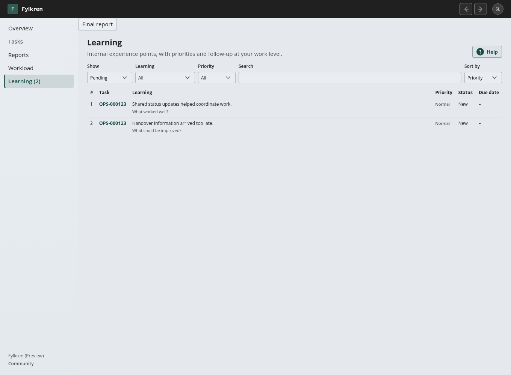
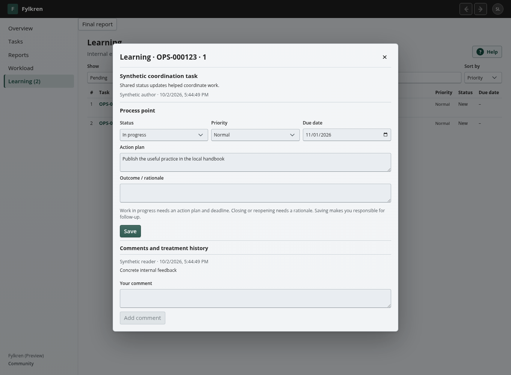

# Internal experience-based learning

Learning points capture practices worth repeating and improvements worth pursuing. They are separate from the final report so operational experience can be discussed internally without being included in reports sent to higher levels or other sites.

## Register points with the final report

The final-report editor contains two numbered lists: **What worked well?** and **What could be improved?**. Use **Add learning point** to add concrete observations. Unsaved points can be removed. Saving validates the report and points together and commits them in one transaction. Existing points remain visible in the editor and retain their original wording, category, author and task-local number. Their treatment continues on Learning after the task is completed.

Points accept 2–4,000 trimmed plain-text characters. A save can add up to 50 points; one task can have up to 100. Stable draft IDs prevent duplicate points if a report save is retried. Each point retains the task reference and the reporting work level where it was registered.

## Work through the queue

**Learning** follows **Workload** in operational navigation. Users with access to their operational level can read points and comment; the leader at that level can prioritize and process them. A top-level leadership position alone does not grant access to subordinate internal learning. The menu counter counts **New** and **In progress** points at levels the current user can lead. Opening a page or adding a comment does not clear the counter.

The default queue shows pending points, sorted by high/normal/low priority, then deadline and creation time. Search matches point text, task title and reference before pagination. Filters select authorized sites/levels, category, priority and pending/closed/all records. Page size is 20. Clicking a point opens its full text, comments and treatment history; clicking the task reference opens the existing authorized task view.

| Status | Required treatment | Queue behavior |
| --- | --- | --- |
| New | May be prioritized before processing | Pending and counted |
| In progress | Concrete action plan and deadline | Pending and counted; overdue deadlines emphasized |
| Implemented | Recorded outcome | Closed history, removed from pending count |
| Closed without action | Recorded rationale | Closed history, removed from pending count |

Saving treatment records the current leader as responsible for follow-up. Every treatment revision keeps an immutable history entry with actor, time, status, priority, action plan, deadline and outcome. Concurrent or stale saves are rejected so another leader's treatment is not silently overwritten. Reopening a closed point requires a fresh rationale and restores the pending count. Comments are retained as plain text with author and time; they do not change the status.

Positive points can become documented repeatable practices. Improvement points should describe an actionable change rather than merely a problem. Review this queue as part of regular leadership follow-up; deadlines, an accountable leader and explicit closure keep it from becoming an unattended permanent list. There are no automatic reminder emails or automatic closure in this implementation.

## Internal boundary and retention

Learning points and their comments are not inserted into report text, report archive responses, print/PDF documents, final-report approval versions, delegation bases or federated official answers. Site administrative audit records the event and task reference without the internal point text. Platform Manager or Site Manager status alone does not grant the operational learning API access.

Complete administrative Site portability exports and database backups include learning data and history for recovery. Such an export is a full Site dataset, not a final report intended for forwarding. The learning records are not deleted when closed; closed history remains searchable and paginated. The migration adds two tables without modifying existing report content or historic task references.

## Browser API

All endpoints require an authenticated active operational context. POST/PUT requests also require the normal CSRF token.

- `GET /api/work/learning`: optional `siteId`, `unitId`, `workItemId`, `view=active|closed|all`, `kind=positive|improvement`, `priority=high|normal|low`, `search`, `sort=priority|due|newest|oldest`, and `page`. Returns authorized levels, items and pagination. Foreign site/level filters are rejected.
- `GET /api/work/learning/{lessonId}/entries?page=1`: paginated discussion and immutable treatment history for an authorized level.
- `POST /api/work/learning/{lessonId}/comments`: `{ text }` with 2–4,000 characters, for members at the level.
- `PUT /api/work/learning/{lessonId}/review`: `{ version, status, priority, actionPlan, treatmentNote, dueOn }`, for the leader at the level. Version conflicts return 409; invalid treatment returns 400.
- Existing `PUT /api/work/sites/{siteId}/items/{itemId}/final-report` accepts an optional `lessons` array of `{ id, kind, text }`. Existing clients may omit it. Learning points are persisted separately from the report.

The navigation-count response adds `learning`, counting only actionable levels and pending states. This feature is available in both Community and Enterprise.
