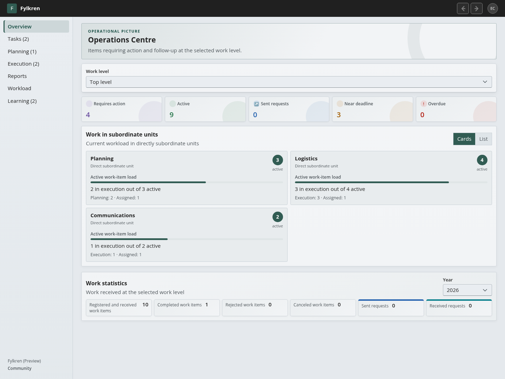
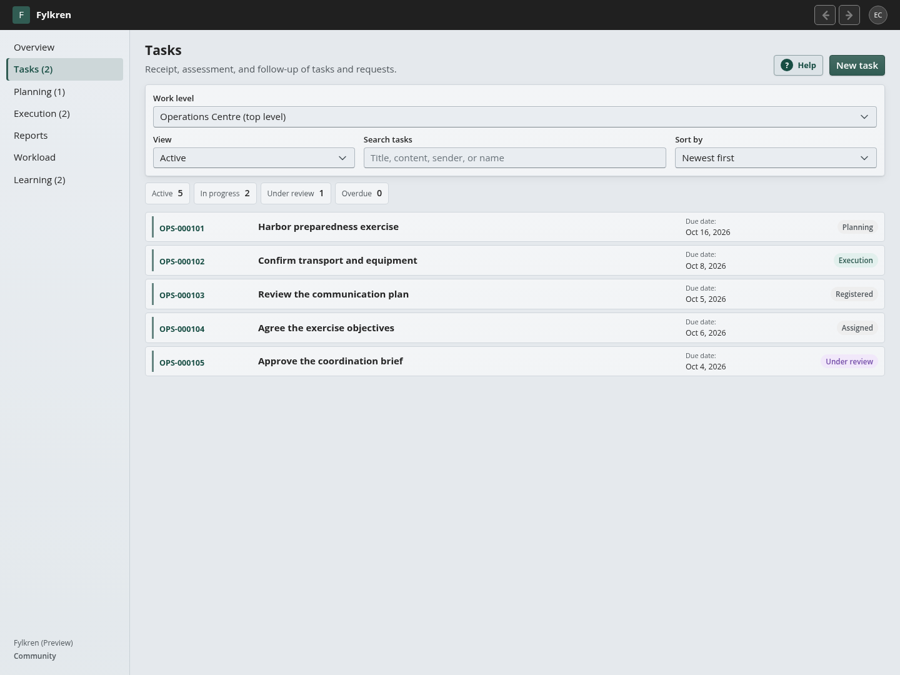
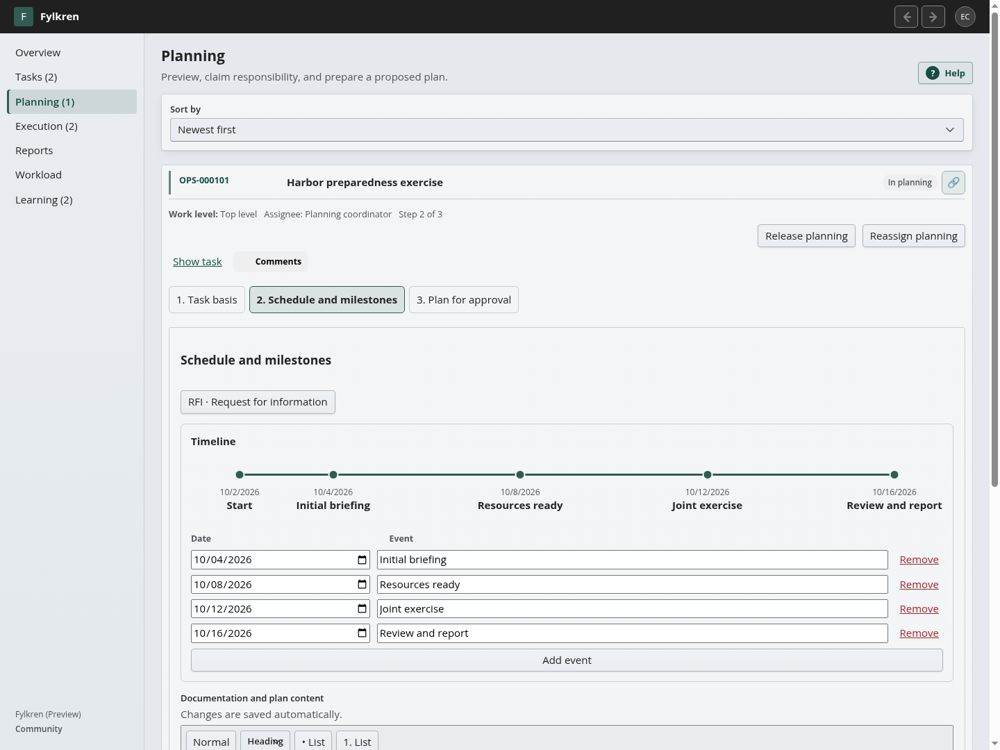
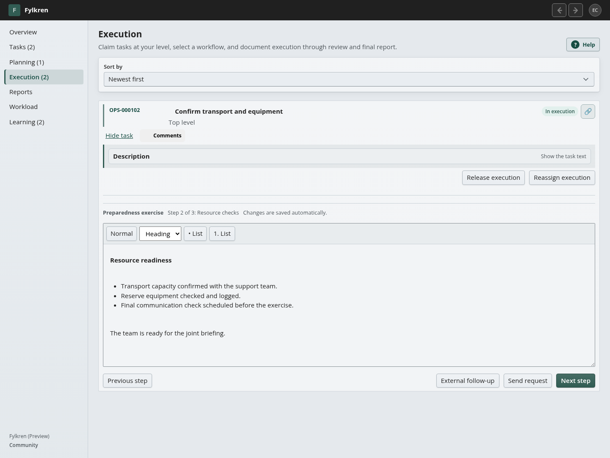
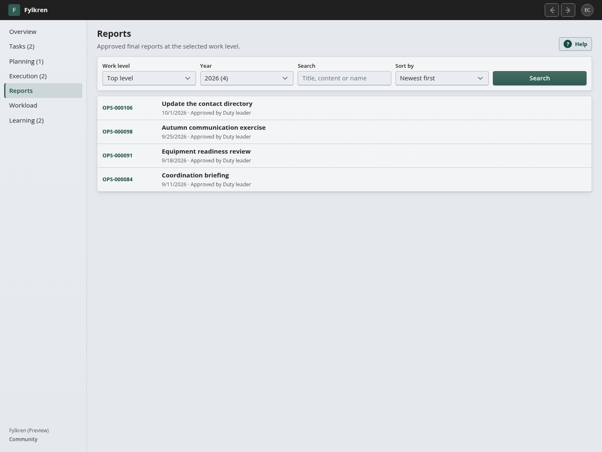
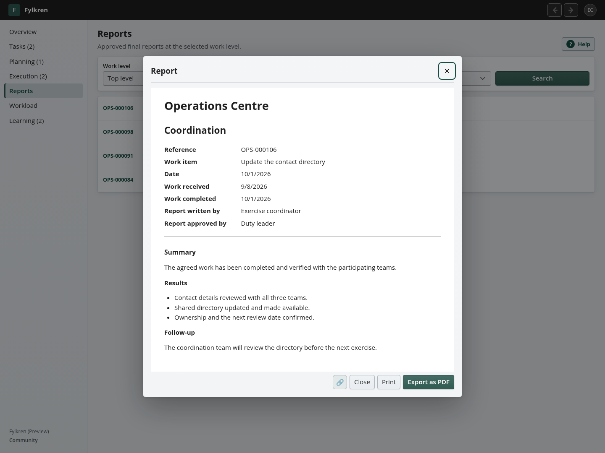

# Complete user and administration manual

This manual explains the supported Fylkren user experience. Configuration and security details link to their authoritative specialist documents instead of being repeated with different rules.

## 1. Concepts

The operational chain is:

**Task or request → optional planning → execution → final report**

Throughout that chain: **Priority → delegation → status → learning → …**
Learning feeds into subsequent assessment, planning and execution. It is an ongoing operational process, rather than a final administrative step. The Learning workspace turns internal observations into prioritized actions and retained outcomes; it does not append those observations to forwarded final reports.

The interface examples in this manual use fictional data and configurable workflows.

A **site** is an independent administrative and access boundary. Inside a site, each operational organizational unit has its own work level. The designated top-leadership unit represents the site top level and is not a separate extra level.

Superior levels assign work, follow aggregate capacity/status and receive formal reports. Subordinate levels control their internal planning and execution. Internally created subordinate tasks remain actionable at their owning level and contribute upward through aggregate workload rather than appearing as superior action items.

## 2. Roles

- **Platform Manager** operates the installation, sites, global identity, email, classifications, appearance, machine APIs, technical logs and platform audit. It has no automatic access to site work.
- **Site Manager** administers organization, personnel, roles, workflows, templates, notification choices and audit in assigned sites. It has no automatic operational authority.
- **Leader** assesses, prioritizes, delegates, approves and reports at one work level.
- **Acting/delegated leader** has the explicitly granted leader authority for a level and period.
- **Planner** prepares plans at an assigned level; approval requires leader authority.
- **Role member** reads level work and contributes to assignments for the role/team.
- **Unit member** may work in Execution at the person's own unit even without a functional role.

Rights are additive but remain independently scoped. A Site Manager who is also a planner receives planner access only at the assigned operational level.

The complete enforcement matrix is in [Access matrix](ACCESS_MATRIX.md).

## 3. Login and Profile

Available first-factor methods depend on installation configuration: local username/email and password, OIDC, SAML 2.0, Active Directory or LDAP. Fylkren then requires TOTP or a one-time recovery code before opening the application. On first use, Profile guides the user directly through authenticator enrollment. A user-verifying WebAuthn passkey can complete multi-factor sign-in directly.

After normal login, the application opens Overview. Profile opens automatically only when a local account must complete its first password change. The profile menu in the top bar contains **Profile** and **Log out**.

Profile supports display name, profile image, personal notification mutes, password changes and MFA/passkey controls. Before mandatory MFA is complete, Profile shows only the required password-change or authenticator enrollment/completion flow. Directory-managed name/email/password fields are read-only; Fylkren TOTP and the profile image remain available.

Administrators issue a one-time reset code rather than choosing a permanent password. Enter the code on the login page and choose the new password before the code expires.

## 4. Navigation and work context

Desktop uses left navigation; mobile uses a hamburger-controlled overlay. Internal back/forward buttons return between application pages without leaving the application. Workload appears immediately after Reports, followed by Learning for operational users.

Tasks, Planning, Execution and Learning display positive pending-work counts in parentheses after their labels. Counts cover the user's authorized work levels across active sites, independently of page filters and pagination. Tasks counts assessment, routing, approval and returned-work decisions for the responsible leader, including answered outgoing requests. Planning and Execution count available work that has not been claimed. Claimed work no longer contributes to those waiting counts; releasing it restores the count. These are pending-work counts, not unread indicators: opening a page does not clear them. Zero counts are hidden. Counts refresh after successful changes, on navigation or returning to the application, and every minute while visible.

Below the Fylkren version in the left navigation, **Community** or **Enterprise** shows the installation's current effective edition. Community is the default. Importing or removing a license updates the label immediately; expiry appears on the next automatic status refresh (normally within one minute). The label follows the server's license status rather than a user role.

Site and work-level selectors appear only when the user has more than one real context. Top level and the designated top-leadership unit are one context.

Task, planning, execution and report permalinks use stable language-neutral IDs. Use the compact link icon to copy a direct link. The recipient must still have normal authorization; possession of the URL grants nothing.

Every data list has a visible sorting control. The available fields depend on the list, and the selected direction is shown. Long lists also support search/filtering and pagination. Sorting applies to the complete result set rather than only the visible page. Ordered structures such as workflows, timelines and organization hierarchies retain their configured sequence by default, but their management views still expose relevant alternative sorting without changing the stored order. Title columns truncate safely instead of widening the page.

## 5. Overview and workload

The Overview heading is the current site name. It presents:

- a **Requires action** summary counter for work the current person/leader can actually act on at the selected level;
- active work, sent requests, approaching deadlines and overdue work;
- direct subordinate units and child sites with recursively aggregated active workload/status;
- annual task statistics appropriate to the level.

The dynamic **Requires action** text list is omitted to keep Overview compact; pending work is signposted in the navigation instead. The summary counter remains and can also include urgency such as overdue or critical work, so it need not equal the sum of the pending-work navigation counts.

Subordinate workload can use card or list view; the preference is personal. Workload bars show active task load on a scale with a minimum of five tasks, so one task is not displayed as 100 percent merely because it is currently the largest value.

Superior users do not receive a subordinate internal task as an action requirement. They see capacity until an explicit report, approval, return or other transition requires their action.

A side request does not replace its source task in **Active**: the source remains one active task, while the request appears separately under **Sent requests**. Once the receiving site answers, the sent request appears under **Requires action** until the sender closes it. After closure, the source task can require its own next decision; closing the request does not silently complete the source task. A received request counts once as active work at the receiving site, and a withdrawal remains actionable there until acknowledged.

The annual statistics include sent requests even when they are side branches of a task. Completed and cancelled requests leave the live **Sent requests** counter but remain in historical annual statistics.

Leaders also have a 12-month workload-history view based only on work recorded in the platform.

## 6. Tasks

### Registering work

Users with registration authority choose **New task** at their current level and provide title, description, optional recommendation, deadline, main-document reference and site-managed metadata such as task type, source type and sender.
Task types default to newest first in both their management list and the new-task selector. A Site Manager maintains them under **References**, where the abbreviation is shown in a separate column and a new type initially proposes the first three valid letters of its name. Source types and senders for manual registration are maintained under the separate **Intake** administration page and default to alphabetical order in the active interface language. A sender received through a request or federation remains an immutable snapshot on that task and is not automatically added to the Site registry. Deactivated values remain visible in management lists but are not offered for new tasks. Operational users can select these values but cannot change the registries.

Every task receives a permanent operator-facing reference when it is created. The task type abbreviation is used when available, for example `INC-000123`; a Site-managed fallback code is used only when no task type is selected. Internal delegation and requests remain in the same reference family: the first child is `INC-000123-1`, its first child is `INC-000123-1-1`, and the next direct child is `INC-000123-2`. The reference is the first field on task, planning, execution and report rows. It is searchable and remains unchanged through planning, execution, approval, completion, reassignment, Site rename and configuration changes. A final report uses the exact reference of the task whose report it is.

Site Managers maintain task types and their abbreviations under **References**. Platform Manager maintains fallback Site codes, chooses the minimum number of digits and advances the shared next unused number under **References**. Only Platform Manager can change Site codes. The number sequence is installation-wide and forward-only, so identical type abbreviations in different Sites cannot produce duplicate references. Intentional gaps are allowed and used numbers are never reused. Existing references are never rewritten by these settings.

Recommendation is decision support for the first leader assessment only; it does not follow the task through later processing. Priority is a leader decision set when the task is accepted for handling.

The primary card is collapsed initially and shows received/registered time, deadline and registering person before content is opened. Description remains a separately collapsible section because it may be long.

### Assessment

At first assessment, an authorized leader can reject, wait, send to planning, send to execution, delegate internally or—after assessment—send a request to another eligible site/level. Available actions are presented together in **Next step**.

Once active child assignments exist, the parent level waits for their reports and cannot start parallel ordinary processing by accident. Reassignment is performed on the relevant child assignment and retains history.

### Dependencies between tasks

Leaders can open **Dependencies** on a task, search for another task in the same site and register that it must be completed first. Several predecessors may be added. Every **Wait** decision also offers the same searchable predecessor selection, including while a plan awaits approval and after approval but before release; a written reason may be used alone or together with dependencies. A blocked task clearly shows the outstanding count and has no ordinary progress actions until all predecessors are completed. The dependency view shows which predecessors are complete and lets an authorized leader remove a relationship. Circular relationships and dependencies to another site are refused with an explanatory message.

### Decisions

Choose **Decisions** on a task to read its decision record. An authorized leader can register a title, the decision itself, its rationale and whether it is a draft or recorded decision. The signed-in user is recorded as decision maker in the simple task interface; the API supports several decision makers and references to tasks, assignments, plans and executions.

Every decision receives a stable ID. Later corrections are stored as new numbered revisions, while all previous wording, rationale, makers, timestamps and references remain available. **Revision** also records creation and revision events, but that technical evidence does not replace the decision record. Recorded decisions create immutable formal versions; more complex approval policies remain future work.

Use **Versions and approvals** on a task to inspect approved plan, report and decision versions. Select two versions of the same object to compare their readable sections; changed fields are highlighted. Approvers, timestamps and integrity checksums remain visible, and the original structured snapshot can be expanded when technical verification is needed.

### Internal delegation

Delegation creates a child assignment at the receiving level while the parent tracking task remains. The receiver can plan, execute and delegate further. The parent sees controlled status and eventually the receiver's approved final report.

The child keeps the parent reference plus a concurrency-safe sibling number. The same rule applies to side requests and plan-created assignments, so every branch can be recognized without inspecting an internal UUID.

When a task was created internally at a subordinate level, it stays in that level's task/action queue. Superior levels see recursive workload, not an ordinary duplicate task.

### Cancellation and completion

The authorized top leader can cancel an entire active chain with a reason. Cancellation is visible throughout the chain and preserves content/history. A completed task has no `Next step`; only its description, plans, execution and reports remain available as collapsed historical sections.

See [Tasks and operational flow](WORKFLOW_AND_TASKS.md) for the complete state/routing contract.

### Activity and information lifecycle

Use **Activity** on a task, planning card or execution card to read the recorded object history. The Overview Activity action shows authorized work across the current Site. Both views use the same event records and support event/object and UTC-date filters, including decisions, risks, mitigation actions, comments and learning. Learning activity is shown only when you also have access to the point’s exact work level; reading a superior or subordinate task does not grant access to its private learning. Activity does not copy the observation or discussion text. Access follows current operational permissions; Site/Platform administration does not grant operational history access. History from before the cutover can be incomplete.

The compact **Lock/Archive** action shows a green square for **Active**, a red padlock for **Locked**, or a blue archive icon for **Archived**. Hover/accessibility text names the state; the dialog identifies the selected task and explains any unresolved prerequisites.

Tasks lock automatically when finally completed with an approved final report, rejected or cancelled; historical reassignment branches also lock. Remaining owned work, planning/execution/risk follow-up and preservation can delay the lock. Required notification/webhook/federation delivery, including failed delivery awaiting resolution, delays **archive**, rather than requiring you to lock the task manually. Archive removes the task from ordinary status lists while retaining its content, references, report and activity. Use **Tasks → Show → Archived** to find it; **All** includes archived history, and search/direct links still respect existing permissions. No arbitrary number of days is used.

Learning points continue under **Learning** independently of task closure/archive. Authorized leaders can treat and comment on them without reopening the task; the original observation and task reference remain protected. Whole-Site archive retains its administrative boundary. Foreign Sites retain ownership of their own counterparts.

For an exceptional correction, an authorized task manager chooses **Reopen for editing** with a reason. This pauses automatic disposition so the task stays editable. On terminal work, **Finish editing** with a reason resumes locking and subsequent archive. A new final operational decision also resumes automation. Reopening information does not change the operational task status or revoke approved report versions. **Cancel** only dismisses the dialog. Permanent deletion, anonymisation and retention execution remain disabled.

## 7. Planning

The timeline ruler places dated milestones relative to the workflow start date. The rows below it edit the same events; changing a date or description updates the ruler and autosaves the plan. This example uses a customer-configured three-step planning workflow.

Planning is optional at every receiving level. The queue is a newest-first paginated list. A qualified user takes responsibility; leaders at the same level may release or reassign responsibility without deleting saved work.

The planning workspace shows the assignment text, relevant approved upstream plans and explicitly shared prior information. It does not duplicate its own plan template above the editable fields.

Fields, links and timeline rows autosave with a short debounce. Moving between steps does not require a separate Save step button. History remains after responsibility is released.

Use the **RFI · Request for information** button in any plan step to keep one shared information-request log for the plan. Add a row and fill in **Who**, **What**, **Due date**, **Answered** (checkbox) and **Answer**. You can write multiline questions and answers; the fields wrap on narrow screens. Changes save automatically. The log stays with the plan when you change steps or when planning responsibility is reassigned, and it can be read with the submitted or approved plan.

The default editable planning workflow is named **Standard**:

1. **Analysis** — includes timeline;
2. **Task**;
3. **Intent**;
4. **Plan** — includes delegation to subordinate units and optional side requests.

Submitting a plan sends it to the level's task view for leader approval. The leader approves or returns it from Tasks, not by entering the planner's workspace. Approval does not dispatch work. The approved task shows **Wait** and **Release** under **Next step**; **View plan** only displays the approved content. Releasing the plan sends its listed assignments and requests exactly once, or proceeds to Execution at the planning level when no child assignment was made.

## 8. Execution

Every assignment is executed at the level that received it, whether or not it was planned first. Execution uses a newest-first paginated queue. Any active member of the level can read the queue and take responsibility; level leaders may release or reassign it.

The user selects an eligible execution workflow. The default **Standard** workflow contains:

1. **Preparations**;
2. **Execution**;
3. **Closure and follow-up**.

Execution fields, links, timeline and internal external-follow-up records autosave. **External follow-up** on the active step's button row opens the log for dialogue conducted outside Fylkren; the platform does not send these messages. **Send request** is a separate button and creates a request that is sent and handled inside Fylkren. The two actions are independent.

Activity history identifies **Step N: Name — Documentation updated** separately from switching to a step and external follow-up. Autosave and Next may save the same content, but unchanged saves do not add history. Three steps are not an activity-count limit: subsequent edits and actual step switches have their own entries. Existing entries remain; older records without a step snapshot show the recorded action without inventing a step number or name.

Only completed execution can be sent to control. `Send to control` is not an alternative to execution.

## 9. Final reports

Open a report by selecting its title. The viewer retains the assignment reference, reporting unit and approval metadata alongside the report content.

Each operational level writes its own final report after its execution and all direct child reports are complete. The default site-managed template contains:

- **Summary**;
- **Execution**;
- **Conclusion**.

The author can inspect collapsed execution history and subordinate reports while writing. A qualified leader approves the report before completion. An approved report cannot be returned. Reporting proceeds upward one level at a time until the primary task closes.

Reports are stored at the level that authored them and appear in a searchable, year-filtered, paginated report list. Printing/PDF starts at the top of the first page and repeats the report's full classification label in the header/footer of every page when present.

The report header always includes the report author's local task reference. Federated inbound work also includes the signed external origin reference as a separate metadata field. Both references are retained in the archived report, print/PDF output, immutable approval version and Report API; customer-edited report body templates cannot remove this system metadata.

Organization headers contain site plus the authoring unit path. For an official cross-site response, only the originating site is exposed. Both sender and receiver archive the accepted official response; the receiver copy acts as a receipt.

## 10. Requests

### Internal request

A work level may request assistance from another level in the same site. Normal internal visibility applies: the relevant assignment basis and history can be shared, the receiver owns active workload, and the approved response returns to the exact sending level.

### Cross-site request

A cross-site request is addressed to an active independent top-level site. It may be a standalone task or a side branch of another task/plan. The sender remains represented by its top-level site name even when an internal subordinate level initiated it; the registering person remains in normal metadata.

The receiver handles it like ordinary work internally, including planning, execution and delegation. The sender sees only coarse states and one approved official top-level response—never the receiver's internal processing or subordinate reports.

Sender may cancel while active. Receiver acknowledges the cancellation and completes its local item. Rejected, cancelled or answered requests remain visible until the responsible sender completes/acknowledges the result, after which counters and active queues exclude them.

For a direct request between independent sites:

1. Register or open a task at the sending level and take it to leader assessment. **Send request** is available only after that assessment. Choose the receiving top-level site and write the instruction intended for it. The original task remains; the request is a separate tracking branch.
2. The receiving site sees **Received request** as its own task. Its leader may assess, plan, distribute and execute it within that site. The sending site sees **Sent request** and the official progress state, but cannot open the receiver's task, planning queue, execution queue or subordinate case history.
3. The receiving site's authorized leader approves its top-level final report and completes the request task. The sender can then read that official response and decide whether to close the request. Closing copies the approved response into the sender's report archive; the receiver retains its own authored report. The two records are linked but belong to different sites.
4. If the sender withdraws an active request, give a reason. The receiving site sees the withdrawal and its leader acknowledges it by completing the local request item. Withdrawal is not silent deletion. Both sides retain the historical record, while terminal requests leave active queues and counts.

Only the receiving site's official top-level response crosses the boundary. A request from a subordinate level still identifies the sending **site** as the official sender; the person who registered it remains identifiable in its own metadata. Internal requests within one site follow different, less restricted visibility rules. See [Tasks and operational flow](WORKFLOW_AND_TASKS.md#cross-site-requests) for the domain rules.

When Site Manager has enabled the relevant email categories, the receiver may be notified of a new request or its withdrawal, and the sender may be notified when the receiver completes its official response. Personal mute choices still apply. An email is a prompt to open the authorized task, not a substitute for the task's status or report; see [Email notifications](../operations/NOTIFICATIONS.md).

## 11. Organization and Personnel

Only Site Manager administers units, personnel, roles and assignments. Leaders can read their own organizational subtree but cannot change it.

People transferred into a site by Platform Manager appear under **No active unit** until Site Manager places them. Placement alone creates no artificial employee role. Assign real leader, planner or work roles as needed.

Directory users are added selectively through search; AD/LDAP never populates the site automatically. Person searches show both name and email to distinguish similar names. Role/person pickers use search rather than loading a large dropdown.

AD/LDAP remains the source for username, name, email, password and directory
account state. Fylkren remains the source for site membership, internal unit,
roles and operational authority. Platform Manager can review automatic lifecycle
status and last-check time under **Identity** and select **Synchronize now**.
When the directory confirms that an account is disabled, expired or repeatedly
missing, Fylkren suspends its directory link and invalidates its active sessions
without deleting memberships, roles or history. An unavailable directory does
not suspend users.

Child sites appear as read-only site nodes in Organization but never as internal Personnel groups.

## 12. Site Manager administration

Site Manager alone sees and edits:

- Organization and Personnel for the assigned site;
- Workflows and Templates;
- Notifications;
- Site Audit.

Workflow/template definitions are administration-only, but active eligible users can use configured content during processing. Site audit excludes Platform Manager actions and other sites. Task-related events display the task reference and title, including planning/execution claims, releases and newly recorded step documentation. Search accepts task references and titles as well as events and actors. Older step events identified only a shared workflow-definition step, so they cannot always be assigned to a specific task reliably. New dependency changes identify the dependent task even after the dependency is removed. References provide audit context; Site Manager status does not grant operational task access.

A new Site receives editable English planning, execution and final-report defaults. These are copied into the Site when it is created; they are not live system translations. Site Manager may translate or otherwise revise them, and application updates preserve the Site's stored versions. Editing a workflow creates a new active version so work already using an earlier version retains its original structure.

### Preserved Site archives

Platform Manager can inspect **Lock/Archive** beside a Site or global user. The Site explanation concerns retiring the entire Site; the person explanation concerns preserving a former user’s attribution after access has already been removed. The primary action and reason come first; custodian, hold/rule and export-custody controls are grouped below under **Archive access and preservation**. For a Site, use **Sites → Edit → Deactivate** first (the resulting operational status is **Inactive**) and resolve the displayed unfinished work, learning, risks and pending delivery. Assign an active archive custodian by name before closure; at least one custodian must have explicit export permission. Custody covers the entire Site, including internal and restricted historical content, and must be assigned deliberately. It grants read/export rights to the preserved archive, without operational membership or work actions. Platform administration alone does not grant archive browsing.

The custodian uses **Archives** to select the preserved Site, read its activity and work, and download the open portable package when export is permitted. An archive-only identity can sign in while its person/login remains active and current custody exists. Reopening the Site or revoking the grant removes that archive entitlement. The final export custodian cannot be revoked while the Site remains locked/archived.

A global person can be locked only after active login/access and archive responsibilities are removed. Historical attribution is preserved; Site archival never locks a globally shared person on behalf of another owner. Reopening the information does not reactivate the Site or account; operational activation is a separate action. These actions do not delete or anonymise information.

## 13. Platform Manager administration

Platform Manager pages include platform Overview/operations, Sites, global Users/Identity, external identity providers, Email and templates, Classifications, Appearance, machine API clients and platform Audit.

On **Identity**, select **Configure** on Local account, Active Directory, LDAP, OIDC or SAML. Save a new or changed external provider while it is deactivated, run **Test stored configuration**, then activate it. Stored secrets are never displayed again. Existing `.env` identity values are imported only when database settings are first created; the GUI is authoritative afterwards. Local account can remain enabled as emergency access even when normal users use AD/LDAP or SSO. **Go directly to OIDC/SAML** bypasses the ordinary login form; `/?local=1` opens the emergency local form. Disabling or changing that provider cancels direct redirect. Local login cannot be disabled until a tested external provider has an active Platform Manager link.

OIDC links belong to the exact issuer plus `sub`; SAML links belong to the exact IdP Entity ID plus permanent NameID. The same identifier text from another provider instance is never treated as the same identity. Each link has **Remove link**. Removal blocks that sign-in but preserves the internal person, memberships, roles and history, and the same identity can later be linked again. The final external Platform Manager link cannot be removed while local login is disabled.

Enterprise features are always visible. When the required Enterprise entitlement is not active, the feature shows one standardized **Requires an Enterprise license** box with a short explanation and **Open License**. Fields and actions remain visible but disabled; Community features on the same page are unaffected. This applies to the machine and report APIs, webhooks, external identity, federation and creation of sites beyond the Community limit.

Sites are shown in an alphabetical hierarchy list. View is read-only; changes—including Site Manager assignment—belong in Edit. Child sites are indented by hierarchy depth. Site deactivation releases operational memberships for reassignment while preserving history.

### Moving or detaching a site

In **Sites**, open **Edit** for the site being moved. Select an active organizational attachment point in the intended parent site, or remove the attachment to make the site independent, then save. A site cannot be placed inside itself or one of its descendants. Missing or inactive attachment points are rejected. **View** is read-only and cannot perform the move.

Before the move, identify any active assignments between the sites. The move does **not** cancel or reroute them: a child site continues to process each assignment in its own task, planning and execution views, and its approved official report returns to the site that originally sent that assignment. The new parent cannot take over that case or read the former parent's case file. New assignments use the new hierarchy; a former parent can no longer distribute new hierarchical work to a site after it is detached. Moving the site leaves its identity, people, internal units, workflows and history intact.

For a concrete example and the information boundary at each level, see [Site model: placement and move invariants](../product/SITE_MODEL.md#placement-and-move-invariants). Site moves should be checked together with active assignments, report archives and workload totals before treating a reorganization as complete.

The global user directory defaults to users without an active site and supports search, site filtering, bulk assignment/reset/deletion and last-login visibility. System Platform Manager accounts are excluded from the unassigned-site queue.

Classification definitions are created, ordered, edited, deleted and activated centrally and then appear as dropdown choices where operational marking is supported. New installations contain no predefined classification types; the customer owns and creates the complete register. Documentation and synthetic tests may use **PUBLIC → INTERNAL → CONFIDENTIAL → SENSITIVE → SECRET** as examples only. Deleting a type removes it from new choices while historical tasks and reports retain their stored marking.

Under **Appearance**, Platform Manager configures names, theme colors and logo. The **Custom CSS overrides** box below Logo accepts up to 20,000 characters and applies the saved rules after Fylkren's standard theme on every page, including sign-in. External resources through `url()` and `@import` are rejected so a style override cannot introduce an additional network dependency. Clearing the box and saving restores the standard CSS without changing the other appearance settings.

The **Language and regional settings** box stores the platform defaults for UI language, IANA time zone, 12/24-hour clock and metric/imperial measurements. Changes apply immediately without restarting the server. American English is the source language and fallback. British English, Norwegian Bokmal and the sixteen additional languages in the maintained roster are complete bundled interface packs governed by the same automated acceptance rules. The selected language applies to the complete interface while the configured clock format independently controls time presentation. Timestamps remain stored in UTC, and changing presentation units never reinterprets stored values.

### Federation between installations

Federation connects two or more independent Enterprise installations. The **Federation** menu item and the entire GUI remain visible to the Platform Manager. Without Enterprise, one clear **Requires an Enterprise license** box appears at the top and actions are disabled. A valid Enterprise license enables the feature; Enterprise licenses issued before federation became available also work without a new license file. Use **Help** on the page for a short in-application explanation. Setup does not send or receive tasks while **Work routing** is disabled.

The maintained [Federation administration guide](FEDERATION.md) is the complete procedure for prerequisites, bilateral identity and fingerprint verification, activation, acceptance testing, delivery monitoring, key rotation, key loss and troubleshooting. The summary below follows the same GUI flow.

1. Confirm that both installations use their final HTTPS addresses, trusted certificates and synchronized clocks. Import a matching Enterprise license on each installation.
2. Select **Create federation key**. Keep the database and Data Protection key volume in the same backup set.
3. Under **Add peer**, enter a recognizable name and the other installation's public HTTPS address, for example `https://fylkren.example.no`. Select **Retrieve signed identity**. The server retrieves the signed identity directly from the peer address; no PNG, key file or other manual identity file is created or uploaded. Compare the fingerprint through an independent channel, select the confirmation checkbox and choose **Approve peer on this instance**. Repeat in the opposite direction on the other installation.
4. Select the peer and run **Test connection** on both sides. The test also retrieves the peer's active top-level sites. Child sites are not exposed separately.
5. Review the status under **Work routing**. When the key, peer, connection and server prerequisites are valid, confirm the verification and select **Enable work routing** independently on both installations. All active top-level sites can then exchange tasks in both directions; there is no additional site-pair or direction approval.
6. Create a normal request to an external top-level site and inspect **Delivery queue**, the sender's receipt status and the new task at the receiver.

Activation and deactivation are immediate and audited; no server restart is required. Deactivation removes remote recipients, pauses queued delivery and closes work-message receipt without deleting peers, tasks, reports or audit history. A site move, peer change, key recovery or catalog withdrawal can stop new routing until identity and catalog state are valid again. Planned key rotation is automatic; confirmed key loss requires independent fingerprint approval and a new connection test at every peer.

Platform Audit contains only platform-administration events. Technical warnings/errors are shown separately in the operations view. Under **Platform → System status**, the maintained host collector shows available disk capacity, the last explicitly registered complete backup, web/API/PostgreSQL container health and restart counts. A missing or stale measurement is shown clearly and never guessed by the application. Backup becomes **Redusert** when no complete set has been registered within the configured threshold, which is 36 hours by default. This status confirms only local creation and registration; Fylkren does not schedule backups or verify external transfer, remote retention or restore. The external backup system should run `sudo ./deploy/compose/backup.sh`, require a successful exit and then transfer only the resulting directory marked `COMPLETE`. Fylkren retains the newest 14 complete local sets by default; `FYLKREN_LOCAL_BACKUP_RETENTION_COUNT` in `.env` accepts 2–365. Incomplete and unknown directories require manual review and are not deleted automatically.

Disaster recovery cannot run inside the application whose database is being replaced. A server operator uses the guarded `deploy/compose/restore.sh` command documented under [Installation and upgrades](../operations/INSTALLATION_AND_UPGRADES.md#restore-and-isolated-rehearsal). An in-place restore on the original server is supported. A rehearsal or replacement server remains isolated until the original instance is stopped or fenced, preventing two installations from using the same federation identity.

## 14. Notifications

Site Manager enables categories for a site; eligible leaders/planners receive events at the exact level. Users may mute categories personally without changing site defaults. New work received across a site boundary is notified like other newly received work.

Platform Manager configures SMTP, templates and sees paginated delivery status, retry and safe failure reasons. See [Email notifications](../operations/NOTIFICATIONS.md).

## 15. Help and troubleshooting

Contextual Help buttons on operational and administration pages explain the local process. When an action fails, the UI should display the safe reason returned by the API, such as duplicate email or invalid state, rather than only a generic failure.

For an unavailable service, Platform Manager checks Operations and technical logs; operators then use [Host status integration](../operations/HOST_STATUS.md), [Installation and upgrades](../operations/INSTALLATION_AND_UPGRADES.md) and [Server setup](../operations/SERVER_SETUP.md). Never delete volumes or edit database migration history as general troubleshooting.

Identity/provider details are in [Access and identity](ACCESS_AND_IDENTITY.md). Machine integrations are documented under [API conventions](../api/API.md).

## Task comments

Open **Comments** beside Dependencies, Decisions, Risk and Versions and approvals on an expanded task card. The same discussion is available from the task links in Planning and Execution. Comments belong to the task rather than an individual workflow run.

Anyone with operational read access to the task can contribute without being assigned to it. Use comments to share existing solutions, relevant experience or information that prevents duplicate work. Comments retain the contributor's name and timestamp and show the newest entries first, with pagination for longer discussions. They can also be added after task completion. Posting a comment does not change responsibility, status, decisions or approval results.

Comments are stored as plain text, recorded in the Site audit and included in Site portability exports and database backups. Posted comments are retained; this initial implementation does not offer editing or deletion. Users without access to the task cannot read or post comments, including Platform Managers without operational access.

## Visual risk assessment

Open **Risk** in the task detail links. The numbered register presents title, description, probability/impact before mitigation, actions, deadlines and residual probability/impact after mitigation. Its [interactive risk map](RISK_MANAGEMENT.md) connects the initial and residual circles for each risk. Select a risk to edit, click a map cell or drag the selected circle, then save the assessment. Enter mitigation actions before residual risk; actions can be edited and completed separately. The scale remains 1–5 with the established low, moderate, high and critical score boundaries.

## Internal experience-based learning

When writing a final report, add numbered learning points under **What worked well?** and **What could be improved?**. They are saved separately from report content and stay internal to the reporting work level. On **Learning**, leaders prioritize points, record an action plan and deadline, comment and close them with an outcome or rationale. Pending points contribute to the menu counter; closed points remain in searchable history. See [the learning guide](LEARNING.md) for access boundaries, workflow and examples.

## Preservation and export custody

Platform Managers open **Lock/Archive → Preservation** for a Site or global user. Add a preservation hold with a reason when information must be kept pending review; release that specific hold with a new reason when the obligation ends. Other active holds remain in force. Hold history is retained. An optional named preservation rule records a review interval without scheduling deletion, anonymisation or an automatic expiry. Choose the immutable rule version that applies to the information.

Export remains a deliberate action. Under **Confirm export custody**, choose the saved ZIP and explain who received it. The browser compares the file against the recorded checksum before confirmation; file contents are not uploaded for this check. Explicit export custodians have the same confirmation control in **Archives**. Confirmation records a handoff, not approval to delete the source or proof that another installation can restore it.
