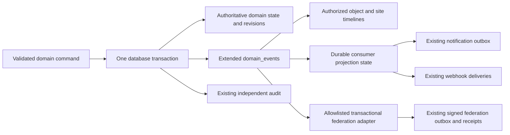
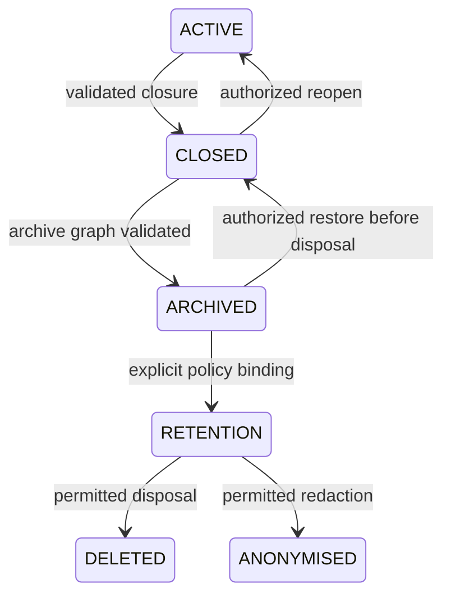

# Event/activity and information lifecycle foundations

Status: **additive foundation and WorkItem vertical slice verified; broader coverage remains step 4**. Reviewed source: `f18cf8214f33ac359d02d39e68c60fd4f41962b5`, 2026-10-02. This document owns the requirements, current-state review, proposed model, migration and acceptance cases for these foundations. The [roadmap](../project/ROADMAP.md) links the delivery order. Existing API contracts remain authoritative until their versioned changes are implemented.

The smallest coherent change is to extend the existing `DomainEvent` and recorder, move operational notification projection off `AuditEvent`, reuse existing delivery queues, and introduce one lifecycle policy/record for locally owned aggregates. Keep current domain state, revisions, approval evidence, state-history metrics and federation contracts. Build both activity views over the same authorized event query. No event sourcing, external broker, second audit log or generic replacement workflow engine is needed.

## Current implementation and conflicts

The following is source-review evidence, not a claim that proposed acceptance tests have run.

| Area | Existing implementation | Gap or conflict |
| --- | --- | --- |
| Common event seed | [DomainEvent.cs](../../apps/api/DomainEvents/DomainEvent.cs), [DomainEventRecorder.cs](../../apps/api/DomainEvents/DomainEventRecorder.cs), [mapping](../../apps/api/Persistence/DomainEventModelConfiguration.cs): UUID, event type/schema, occurrence time, site, nullable person, resource type/ID, JSON payload; added to the same EF context as the mutation. | Six externally supported names; no explicit source, remote/system actor, originating instance/site, correlation/causation, root work context or general projection bookkeeping. Null actor has ambiguous meaning. `WebhooksProjectedAt` mixes immutable business fact with one consumer's progress. |
| Task/assignment changes | [creation](../../apps/api/WorkManagement/PrimaryWorkItemCreationEndpoints.cs), [status](../../apps/api/WorkManagement/WorkItemStatusEndpoints.cs), [planning approval](../../apps/api/WorkManagement/PlanningApprovalService.cs) write audit and selected domain events. | Many state/edit/request/report changes only write audit. `assignment.created` can refer to resource type `task`; task/assignment terminology does not identify a separate assignment aggregate. A receiving-site event can omit the source person but also omit explicit source-site attribution. |
| Planning/execution | [planning documents](../../apps/api/WorkManagement/PlanningDocumentEndpoints.cs), [submission](../../apps/api/WorkManagement/PlanningSubmissionEndpoints.cs), [execution start](../../apps/api/WorkManagement/ExecutionWorkflowEndpoints.cs), [workflow mapping](../../apps/api/Persistence/WorkflowModelConfiguration.cs). | Plans are `WorkflowRun`; execution has its own run. Domain events cover approval/start, not the full lifecycle. Workflow/ExecutionTimelineEvent stores editable, user-entered dates/descriptions for the planning ruler, not immutable activity. Editing replaces timeline entries. |
| State/history metrics | [WorkItemStateHistory.cs](../../apps/api/WorkManagement/WorkItemStateHistory.cs), `capture_work_item_state` trigger in [baseline migration](../../apps/api/Persistence/Migrations/20260919154027_InitialBaseline.cs), [work mapping](../../apps/api/Persistence/WorkItemModelConfiguration.cs). | Trigger captures insert/status/site/unit changes for historical workload, without actor or causation. It is useful specialized history, not a complete activity stream. Removing it would change workload evidence. |
| Decisions | [DecisionEndpoints.cs](../../apps/api/Decisions/DecisionEndpoints.cs), [decision mapping](../../apps/api/Persistence/DecisionModelConfiguration.cs). | Independent immutable numbered revisions, makers/references and audit; domain emission includes creation as `decision.recorded`, with incomplete subsequent activity coverage. Preserve revisions as content authority. |
| Risks/measures | [RiskEndpoints.cs](../../apps/api/Risks/RiskEndpoints.cs), [risk mapping](../../apps/api/Persistence/RiskModelConfiguration.cs). | Risk and mitigation revisions and audit are independent of common domain events. Risk closure is a revision status, not a common activity fact. Mitigation audit currently uses entity type `risk` even for a mitigation ID: a generic resolver cannot safely assume all those IDs identify Risk. |
| Reports/approvals | [WorkItem.cs](../../apps/api/WorkManagement/WorkItem.cs), [ReportQueryEndpoints.cs](../../apps/api/WorkManagement/ReportQueryEndpoints.cs), [formal approval service](../../apps/api/Approvals/FormalApprovalService.cs), [EF context](../../apps/api/Persistence/FylkrenDbContext.cs). | Final report fields live on WorkItem; the report archive is a completed/approved query, not an archive state. Immutable DomainObjectVersion/Signoff are protected against tracked modification/deletion. Activity must link these versions, not duplicate report bodies or replace approvals. |
| Comments/learning | [comments](../../apps/api/WorkManagement/WorkItemCommentEndpoints.cs), [learning](../../apps/api/Learning/LearningEndpoints.cs). | Separate content/treatment history and audit. Internal learning is deliberately excluded from ordinary reports/federation. A general site timeline must not expose it through metadata. |
| Notifications | [NotificationDeliveryWorker.cs](../../apps/api/Notifications/NotificationDeliveryWorker.cs), [mapping](../../apps/api/Persistence/NotificationModelConfiguration.cs). | Reads `audit_events` using an occurrence-time/UUID cursor, maps audit names and resolves current domain data. Durable outbox deduplicates `(AuditEventId, RecipientPersonId)`. Thus audit schema/retention affects operational delivery; timestamp ordering is not proof of transaction commit ordering. Documentation previously described notifications as domain-event projections. |
| Webhooks | [WebhookDeliveryWorker.cs](../../apps/api/DomainEvents/WebhookDeliveryWorker.cs), [WEBHOOKS.md](../api/WEBHOOKS.md). | Reads domain events, maintains unique subscription/event deliveries, attempts, HMAC and retries; Enterprise entitlement pauses processing. Same business fact has a different source from SMTP. Worker concurrency claims/durable projection state require explicit migration tests; a polling query alone is not an exclusive claim. |
| Federation | [receive](../../apps/api/Federation/FederationWorkReceiveEndpoints.cs), [outbound queue](../../apps/api/Federation/FederationOutboundWorkQueue.cs), [return queue](../../apps/api/Federation/FederationOperationalReturnQueue.cs), [receipt](../../apps/api/Federation/FederationInboundReceipt.cs). | Signed versioned contracts, local counterpart records, origin addresses, correlation/causation, nonces, durable receipt/outbox and some audit/domain writes already exist. This is specialized transport state worth retaining; sending generic activity would disclose internal data and duplicate protocol mechanisms. |
| Security/audit | [AuditEvent.cs](../../apps/api/ActivityAudit/AuditEvent.cs), [audit mapping](../../apps/api/Persistence/AuditModelConfiguration.cs), [machine audit](../../apps/api/Platform/ApiMachineAuditEvent.cs), [SecurityEventMiddleware.cs](../../apps/api/Platform/SecurityEventMiddleware.cs). | Audit mixes operational and administrative facts, with constrained local/federated/system actors and actor-role snapshot. Request rejection also goes to technical logs. Audit is not a full operational activity model, and activity is not a substitute for audit. No event replay or stronger tamper-evidence guarantee is inferred. |

There is partial parallel implementation, not six completely interchangeable copies: revisions preserve content, the state trigger preserves metric intervals, audit preserves accountability, events support integrations, outboxes preserve delivery, and planned timeline entries preserve a schedule. Duplication to remove is independent business-event naming/emission and deriving notifications from audit; preserve these distinct responsibilities.

### Current deletion, archive and retention behavior

| Object/data | Actual behavior at reviewed revision | Architectural consequence |
| --- | --- | --- |
| Site | [OrganizationEndpoints.cs](../../apps/api/Organization/OrganizationEndpoints.cs) maps DELETE to [SiteDeactivationService](../../apps/api/Organization/SiteDeactivationService.cs). Blocks active child sites, sets inactive, suspends federation publication, deactivates memberships/managers/roles, removes unit memberships and releases claimed runs. Keeps domain rows. | Deactivation is access/operation shutdown, not physical deletion or archive. Open work, reports and linked cross-site work are not comprehensively dispositioned by this operation. Former members lose ordinary historical access; an archive reader/custodian model is absent. |
| Person/login | [PlatformUserBulkEndpoints.cs](../../apps/api/Platform/PlatformUserBulkEndpoints.cs) blocks self/platform-manager deletion and active site associations; [Person.Delete](../../apps/api/Identity/Person.cs) clears email/image, retains UUID/display name and marks deleted. LoginIdentity replaces the username with a deleted-ID marker and clears password/MFA material. [IdentityDeletionService](../../apps/api/Identity/IdentityDeletionService.cs) removes passkeys/external links, revokes reset grants and deletes authentication material through LoginIdentity. | Auth shutdown and partial personal-data removal preserve references, but are not complete anonymisation: display names, authored text and copied attribution/contact snapshots can remain elsewhere. Site membership removal is independent of global person deletion. |
| Tasks/assignments | WorkItem has operational terminal states and restrictive site/parent/person/reference FKs. Reassignment can reopen work. No general purge/retention endpoint exists. | Terminal status must not automatically equal archived or retention eligible. Other sites' counterparts remain independently owned. |
| Plans/execution/templates | Runs and content remain. Definition/template DELETE deactivates configuration. Draft requests/RFI and step timeline/content editing can remove/replace rows; several run-child FKs cascade. | Do not interpret configuration deactivation or editable planning entries as aggregate archive. Cascades require an explicit disposition graph before any physical aggregate purge. |
| Reports/decisions/risks/measures | Reports embedded in WorkItem; decision/risk/mitigation numbered revisions; formal approval snapshots/signoffs retained. Mostly restrictive relationships. | There is no common information lifecycle or retention policy binding. Closure and archival differ, and immutable history cannot be bypassed with bulk SQL during future purge. |
| Attachments/references | Stored profile images are binary person data. [portable exporter](../../apps/api/Portability/PortableExportPackage.cs) currently exports those images; operational document references are links, not uploaded files. Branding logos are separate stored settings. | Do not invent an existing general attachment store or attempt to delete external files. Future uploads must inherit owner scope, policy and holds; shared-person images have a global rather than site-local deletion decision. |
| Activity/audit/delivery | Domain/audit event resource IDs are largely logical references rather than object FKs. Webhook deliveries restrict event deletion; attempt rows cascade from deliveries. Notification records retain rendered content and recipient snapshots. | Keeping only domain rows cannot preserve privacy or history consistently. Deletion must address copied payloads/outboxes/snapshots as well as canonical content; tombstone resolution must avoid unauthorized joins. |
| Technical retention | [ApiMaintenanceWorker.cs](../../apps/api/Platform/ApiMaintenanceWorker.cs) removes API idempotency records after seven days, expired WebAuthn grants after an extra day and probe nonces after seven days. Federation retention is configurable, currently default 2555 days and constrained to 365–3650 in [FylkrenOptions.cs](../../apps/api/Platform/FylkrenOptions.cs). | These existing numbers are observations, not proposed new policy. Separate ephemeral protocol cleanup from customer-information and security-audit retention. |
| Federation history/audit | Maintenance deletes delivered outbound messages and receipts only for terminal work, but its federation audit DELETE selects old rows by actor/event naming without requiring terminal work. Operations are separate SQL statements. | One federation duration governs distinct record classes, can remove audit for still-active relationships, and has no common hold/export gate. Receipt removal also changes the deduplication horizon. This conflicts with a unified lifecycle and needs dedicated integration tests before replacement. |
| Portability/exit | Site ZIP/JSONL export includes domain/history/audit/events, formal versions/signoffs, learning/comments, sanitized integrations/delivery records and profile images; excludes credentials. Validator checks package without applying it. | Export performs multiple reads without an encompassing snapshot transaction. A live-changing site can therefore yield inconsistent related datasets. Federation links/receipts and exit acknowledgements are not covered as dedicated datasets. Import apply is deliberately absent. A portability package is neither full restore nor confirmed customer delivery. |

[Security and retention](../security/SECURITY_AND_RETENTION.md) and ADR-003 describe preservation/sanitization principles. General retention, holds, aggregate archive and controlled sanitization are not implemented simply because those principles are documented. The exporter's manifest currently lists credential exclusions, but does not enumerate omitted federation datasets; the exit review must make those limitations explicit rather than claiming a complete transferable relationship graph. Source review identified these conflicts; no new vulnerability finding or ASVS pass is claimed by this design review.

## Requirements and implementation/test traceability

IDs here are architectural requirements, not a second security-testing matrix. The delivery evidence below distinguishes verified foundation components from **planned** integration cases. A foundation assertion does not mark an entire acceptance case as passed. Existing files identify extension points, not compliance with these new requirements. Test cases T01–T14 are defined later in this document; security execution/status continues solely in the [ASVS matrix](../security/ASVS_5.0.0_L2_MATRIX.md).

| ID | Requirement | Smallest implementation/extension point | Acceptance cases |
| --- | --- | --- | --- |
| EA-01 | Significant local/system/federated facts have a stable ID, times, typed name/version, actor, origin, owned resource, context, correlation/request/causation and bounded metadata. | Extend existing DomainEvent/recorder and mapping; typed catalogue/context factory. | T01, T02, T06 |
| EA-02 | Current domain state/revisions remain authoritative; business mutation, event and necessary audit/outbox writes commit or roll back together. | Shared recorder used by existing command services/endpoints; keep WorkItem/revisions/state trigger. | T01, T02 |
| EA-03 | One semantic catalogue drives activity and eligible consumers; retries/import/backfill do not create duplicate business facts or deliveries. | Consumer projection state and idempotency keys; existing notification/webhook/federation queues. | T03, T04, T05 |
| EA-04 | Audit/security logs remain independent with existing actor/role/access guarantees and optional event correlation. | Add nullable correlation/event references to existing audit records; never derive security audit from activity. | T01, T06, T11 |
| EA-05 | External v1 webhooks/federation remain compatible and entitlement-gated; private/internal data is not generically exported. | Versioned allowlisted adapters over existing outboxes/contracts. | T04, T05, T06 |
| TL-01 | One timeline capability supports object/root context and site-wide views, filtered by event/object type, authorized site and time. | One ActivityQueryService and reusable web component with object/site wrappers. | T07, T08 |
| TL-02 | Timeline rows, counts, filters, metadata, links and tombstones enforce current object and archive access; stable bounded pagination. | Existing WorkItem/organization/learning policies plus explicit archive grants and opaque cursor. | T06, T07, T08 |
| LC-01 | Information disposition follows ACTIVE → CLOSED → ARCHIVED → RETENTION → DELETED/ANONYMISED independently of operational status. | Common lifecycle record/policy for aggregate roots, dependent objects inherit through a typed registry. | T09, T10 |
| LC-02 | Archive/close/deletion validates dependency graph, owner site, current revision and unfinished work; no cross-owner cascade. | Aggregate-specific adapters and one LifecycleService for transitions/impact plans. | T09, T10, T12 |
| LC-03 | Policy/hold/authority/reason/export are prerequisites to irreversible disposition; absent policy never means automatic purge. No new durations now. | Nullable policy binding, hold references and resumable disposition job; no purge worker in the first slice. | T10, T11, T12 |
| LC-04 | Users/sites can cease operation without breaking attribution; full anonymisation includes copied personal data and shared-person boundaries. | Existing deactivation/auth cleanup plus archive access and explicit redaction inventory. | T06, T10, T11 |
| LC-05 | Federated/local cross-site counterparts remain owned by each recipient; transport/replay evidence outlives required protocol operations. | Existing work links/receipts/outbox, per-owner lifecycle adapters and negotiated protocol gates. | T05, T12 |
| LC-06 | Attachments, content, events, audit, delivery copies, approved versions and backups have explicit disposition handling, not uncontrolled cascades. | Typed dependency/export/redaction registry; independent audit/protocol policy classes. | T10, T11, T12 |
| LC-07 | Export before deletion provides a verified consistent customer package, stable references, documented exclusions and an offline exit path. | Snapshot-capable PortableExportPackage and versioned format, export receipt bound to disposition plan. | T12, T13 |
| MG-01 | Upgrade/backfill/cutover is resumable, produces no old-event delivery storm and does not maintain two permanent mechanisms. | Additive EF migrations, legacy provenance/mapping and per-domain notification cutover. | T03, T04, T14 |

## Common event/activity model

### Semantics and ownership

Extend `domain_events`; do not add an `activity_events` table with duplicate facts. Activity is an authorized read representation of domain events, not a second write stream. Events say what happened; decisions/revisions/approvals say what was decided or approved; WorkItem/run state says what is true now. Specialized history remains until its consumers can be shown equivalent.

Use `OwnerSiteId` (existing `SiteId`) for local ownership/visibility and separately `OriginInstanceId`/`OriginSiteId` for provenance. These must not be conflated. A receiver writes a local `assignment.received` event about its own WorkItem, with a verified remote site actor/origin. The sender's event concerns its own tracking branch. They correlate, but are not duplicates or a shared mutable record. Remote person IDs/names do not become local identity/authority.

In today's model both task and assignment resolve to WorkItem; canonical new resource type is `work_item`, with `workKind`/event semantics distinguishing assignment/request/internal task. Plan resolves to WorkflowRun, measure to RiskMitigation. A report currently resolves to the final-report facet of WorkItem (`resourceType=report`, same WorkItem ID), plus immutable version ID when available. Do not create a Report or Assignment table just to satisfy event naming.

### Proposed envelope and storage

| Field | Storage/meaning |
| --- | --- |
| `Id` | Existing locally generated UUID, immutable, stable through projection/retry. External IDs never overwrite it. |
| `EventType`, `SchemaVersion` | Existing bounded fields; catalogue validates supported semantic type and metadata schema. Event schema and external envelope version are separate. |
| `OccurredAt`, `RecordedAt` | UTC business occurrence plus local insertion time. Remote occurrence is bounded/marked as peer-reported; display never treats it as verified local commit time. Legacy RecordedAt may be unknown; do not invent it. |
| `OwnerSiteId` | Existing SiteId retained physically for compatibility; local site owning this fact. New facts require an owner; global security/administration stays in audit rather than fabricating a site. |
| `ActorKind` and actor fields | Discriminated person/machine/system/federated-site/legacy-unknown. Person ID for local actor; authenticated API client ID for machine actions; bounded system identifier for jobs; verified peer instance/site identity for federated effects. Nullable existing actorPersonId retained. Database checks reject mixed actor forms. |
| `OriginInstanceId`, `OriginSiteId` | Composite origin address; remote UUIDs are provenance, not local FKs. Unknown legacy origin remains explicitly unknown. Local source obtained server-side. |
| `Source` | `local`, `system`, `federated`, plus `legacy` provenance for historical imports/backfill. Provenance is never a permission. |
| `ResourceType`, `ResourceId` | Catalogue-resolved locally owned object/facet; logical reference checked by writer and typed resolver. Existing resource names stay valid for legacy rows/v1 adapters. |
| `ContextWorkItemId`, `ResourceRevision` | Nullable local root/context for object-wide activity and authorization; revision/version ID/number only where the domain supplies it. Context must belong to the owner site. No foreign site's internal parent IDs. |
| `OperationId`, `CorrelationId`, `CausationEventId`, `RequestId` | Server-generated command-operation UUID separate from the work-chain correlation UUID, optional preceding fact and bounded request/trace identifier. Reuse operation identity from a validated idempotency record or inbound receipt for retries. Remote protocol correlation recorded separately or as a namespaced origin address; never blindly trust an HTTP header as authority or uniqueness. |
| `SourceMessageId`, `SourceEventId`, `EffectKey` | Optional verified protocol identity/provenance, namespaced by peer. Effect key distinguishes multiple legitimate local facts from one message. Existing receipt remains the authoritative inbound deduplication boundary. |
| `Metadata` | Existing jsonb PayloadJson extended with per-type DTO/schema, size/depth/field allowlist. Contains reference/revision/status changes and a safe summary code; excludes passwords, tokens, contact lists, whole report/decision/learning text and arbitrary before/after object serialization. |

Actor/site display comes from authorized resolvers or minimal permitted snapshots, with neutral fallback for redacted identities. Do not duplicate personal display names into every event by default. An audit link can use the same correlation ID and a nullable DomainEventId on existing audit rows; an event can have several audit records, or none when no audited action is required. Audit must still be recorded for rejected/security actions that produce no domain event. Correlation/event references are immutable logical IDs or restrictive links; disposal of activity must never cascade-delete or silently rewrite an audit record.

Add indexes for `(SiteId, OccurredAt, Id)`, `(SiteId, ContextWorkItemId, OccurredAt, Id)` and `(SiteId, ResourceType, ResourceId, OccurredAt, Id)`; add type/time indexes only for measured queries. Polymorphic resources have no universal FK: the typed writer/resolver/disposition registry owns integrity, rejects foreign-site context and preserves tombstones. Actor/origin/metadata become immutable after commit; consumer bookkeeping and authorized lifecycle redaction are separate. Enforce via restricted write paths/EF guards and database permissions/constraints where appropriate; administrative SQL can bypass application guards and is not claimed tamper-proof.

### Catalogue and meaning

| Canonical new fact | Exact trigger and resource |
| --- | --- |
| `assignment.created` | Locally owned assignment/request WorkItem persisted; not proof of sending or acceptance. Ordinary internal task creation can retain `task.created`. |
| `assignment.sent` | Receiver durably acknowledges an accepted handoff. Local same-database handoff commits sender/receiver facts together; federation emits sent only after verified receipt. Queueing is `assignment.dispatch_queued`, distinct from sending. |
| `assignment.received` | Receiver's local WorkItem/counterpart created and receipt committed; verified message replay emits nothing new. |
| `assignment.accepted` | Responsible receiving leader commits the assessment/routing decision accepting responsibility. Registration, transport receipt and a worker claim do not imply acceptance. Add this explicit semantic mapping to existing assessment commands, not a new status solely for an event. |
| `assignment.started` | First committed start of actual work; metadata states whether planning or direct execution. Later phase entry is phase-specific activity. |
| `assignment.updated` | Accepted material content/routing/revision change; changed-field names and revision, no generic SaveChanges noise. |
| `assignment.completed` | Receiving level has completed the existing required report/approval controls. Sender receipt/closure is a separate local event; peer progress alone cannot complete it. |
| `assignment.cancelled`, `assignment.reassigned`, `assignment.reopened` | Existing successful domain transitions, not destructive history edits. |
| `plan.published` | WorkflowRun approved and released by existing approval/distribution transaction. Submission for review is `plan.submitted`; draft save is `plan.updated`. |
| `plan.updated`, `decision.created`, `decision.updated` | Successful plan content or numbered decision revision, linked to context/revision; no duplicate body snapshot. |
| `risk.created`, `risk.updated`, `risk.closed` | Risk revision created; close emitted only when status transitions to closed, not every revision already closed. |
| `measure.created`, `measure.updated`, `measure.completed` | RiskMitigation creation/revision/status transition with explicit measure resource and risk/work context. |
| `report.updated`, `report.submitted`, `report.approved` | Existing final-report facet changes and approval controls, with immutable version reference at approval. |
| `information.closed`, `information.archived`, `information.retention_started`, `information.redacted`, `information.deleted` | Explicit information-lifecycle operations, independent of operational completion; minimal fact/tombstone metadata. |

Keep v1 `task.created`, `task.completed`, `assignment.created`, `plan.approved`, `execution.started`, `decision.recorded` contract semantics. Do not rename previously delivered events or silently equate an assignment-created webhook with a receipt. A catalogue adapter can serialize one canonical stored fact as the existing v1 name/resource for existing subscriptions. Richer names/types require an opt-in documented contract version. A subscription receives one representation of a fact, never canonical plus legacy alias by default.

### One recording path and consumer integration

An EventContextFactory derives authenticated person/machine, trusted system or verified-peer context. Machine actor identity/scopes come from the existing machine authentication boundary, never from a client-supplied person ID. Existing application commands call one typed recorder **after** domain validation and **inside** the business transaction. No generic HTTP middleware emits successful domain events, and no automatic audit-to-event mirror remains permanently. Commands with several effects emit several explicit correlated facts; a retried idempotent command returns the original result/fact IDs. New facts use a semantic effect key and a unique operation/owner/resource/type/effect constraint. Browser commands without an idempotency key still rely on existing version/state locks: a no-op repeated transition emits no new fact, and a stale conflicting command is rejected. CorrelationId alone is not an idempotency key because one work chain legitimately contains many facts.

Introduce one small `event_projections` table keyed by `(Consumer, DomainEventId)`: status (pending/processing/completed/skipped), lease owner/expiry, attempt count, next attempt time and bounded failure reason. Recorder inserts relevant consumer rows atomically with the fact. Existing events carry explicit historical/cutover eligibility; absent licence pauses, rather than discarding, already eligible work according to current entitlement rules. Snapshot subscription eligibility and required recipient/routing inputs at the accepted operation boundary; projection must not infer old decisions from today's names, hierarchy or state. Consumer-only personal snapshots belong in their existing outboxes, never general activity metadata.

Workers atomically claim committed pending rows, use expiring leases/row locks and commit projection completion with unique outbox insertion. Late transaction commit cannot be lost because scanning is by pending state, not a wall-clock or sequence high-water mark. Sequence allocation is not commit ordering either. External delivery stays at least once; consumers deduplicate using stable event/message IDs. Crash after successful remote delivery can retry; do not promise exactly-once SMTP or webhook transport.

Notifications extend `notification_outbox` with nullable DomainEventId and NotificationKind, retain legacy AuditEventId for history, and use a unique `(DomainEventId, RecipientPersonId, NotificationKind)` key for new rows. Extract the existing preference/recipient/template enqueue logic into one adapter: for migrated commands it projects the recorded domain fact inside the business transaction and freezes the eligible recipient/routing/template/content snapshots into the existing outbox, marking its projection complete. SMTP delivery alone remains asynchronous. This avoids reconstructing old notification content from a changed WorkItem without introducing per-edit event-sourcing snapshots. Deferred projection is allowed only with a reference to an existing immutable authorized domain revision/input; it cannot query mutable current state as historical truth. Reuse retries/SMTP delivery and remove the old audit cursor after controlled cutover. Delivery workers need exclusive, recoverable claims in their existing queue; external transport still cannot guarantee exactly once. Webhooks retain their subscription/event unique key, attempts/signing/retries, moving WebhooksProjectedAt into shared projection state. This is one source of business facts with distinct delivery records, not one generic delivery format.

Federation first adds SourceDomainEventId/correlation to its existing queues. Existing transactional routing/grant checks, allowlisted assignment/progress/report/cancellation adapters, signatures, receipts and nonce checks remain. Keep current transactional enqueue when required for reliable handoff; a shared event adapter writes the existing outbox in that transaction. Do not add an asynchronous second federation dispatcher, reuse webhook payloads for federation or broadcast every event. Local private comments/learning/risks/plans remain local unless an explicit future contract authorizes them.

Activity recording, local timeline and lifecycle foundations are core Community/Enterprise behavior; existing licensed integrations remain entitlement-gated adapters. Licence loss cannot remove local history or silently authorize deletion.

Reporting initially continues reading authoritative domain state and workload history. It may later consume events for throughput/lead-time metrics with clearly defined counting semantics, but must not reconstruct permissions, approval or current business state by replay.

## Explicit information lifecycle

RETENTION means a managed disposition stage, not that earlier data lacked retention protection. A record may remain CLOSED/ARCHIVED indefinitely pending a valid policy; there is no default countdown or new arbitrary duration. A hold can block progression/disposal in any stage. DELETED and ANONYMISED are terminal for the disposed revision/content; restored backups must not silently resurrect it.

Operational `Status` and `IsActive` remain authoritative for work progress and login/routing. A completed WorkItem can still have open learning, dependencies or a report-return obligation. Initial backfill sets lifecycle ACTIVE unless closure eligibility is actually proven; existing completed work is not automatically archived. Site deactivation and person auth shutdown take effect immediately even if their information graph is not ready for closure.

### Data model and aggregate boundaries

One `information_lifecycle` record per independently owned root: unique `(OwnerSiteId, ResourceType, ResourceId)` for site-owned roots; an explicit global ownership scope for shared Person/platform configuration, with a check that global/site forms do not mix. Fields: current stage, stage-change times, concurrency revision, nullable policy/version binding, nullable eligibility/review date, disposition operation/export reference and sanitized reason code. Existing business entities do not receive a competing generic business status. A typed adapter derives business closure prerequisites and identifies the owning root for each dependent.

WorkItem owns its local plan/execution, report facets, content and local contextual records, but decisions/risks with multiple references can require independent disposition. References are not ownership: a Decision pointing at a WorkItem is a blocker or a preserved tombstone link, not permission to cascade-delete it. RiskMitigation usually inherits its Risk policy. A shared Person, a peer-owned counterpart, or another site's tracking branch never becomes a site-owned child just because it is referenced.

A lifecycle transition registry returns an impact graph: owned dependents, external/local-cross-site references, open obligations, immutable evidence, pending deliveries, holds, bytes/attachment owners and eligible actions. Changes are optimistic-concurrency checked and revalidated in the transaction; graph plans bind to resource revisions. Holds/policy changes acquire the same disposition lock so a check cannot race a purge. Use explicit ownership relations and Restrict, not accidental cascade traversal.

Future configurable policy records distinguish customer content, activity, security audit, delivery diagnostics, replay/idempotency evidence and backups. Each policy defines authority/scope, trigger, action and optional duration; store the version used for a decision. Holds are separately identified, authorized, reason-coded and traceable, applying to a root/dependency set and relevant evidence. No tenant UI, durations or automatic purge schedule is introduced in this review or first implementation slice.

### Relationship-aware behavior

| Subject | Close/archive/disposition rule |
| --- | --- |
| Site | Disable new operations/routing first without calling that deletion. Resolve/move child sites, open assignments, outstanding reports/returns, unsent outboxes and custodianship. Archive local records read-only under explicit historical access. Preserve site ID/minimal reference tombstone while owned/dependent records or another site refer to it. Physical site deletion is unavailable while unresolved references remain. |
| Users | Distinguish membership removal, account deactivation, auth-material removal and personal-content redaction. Shared Person deletion requires review across all associations; one site's manager cannot redact another site's attribution. A deleted marker/cleared email is not anonymous while names/snapshots remain identifiable. |
| Historical access | Current authentication and explicit `history.read`/`history.export` grants for archived scope are needed. Inactive memberships do not automatically grant history. Platform Manager keeps administrative authority without automatic operational timeline access. Design the identity-eligibility exception for an active archive custodian explicitly; never reactivate every former member to make exports work. |
| Assignment/task | Close only when existing workflow/report and counterpart obligations permit. Archive freezes editable operational content through all API paths; deliberate reopen produces a correlated fact and rechecks policy/holds. Restricted tasks stay restricted. |
| Plans/reports/decisions/risks | Retain numbered versions, signoffs and original references. Approval history remains immutable through ordinary commands. Future permitted redaction is a dedicated reasoned disposition operation with minimal evidence, not a normal revision edit or bulk-SQL escape from approval guards. |
| Cross-site work | Each owner archives its local record separately. Keep safe address/reference/status evidence and official report rights; no cascade into another site and no local actor/name disclosure through parent/root joins. Local deletion does not revoke another owner's approved report copy. |
| Federated work | Close transport obligations and preserve origin/correlation, counterpart link and required dedup evidence before disposal. Never infer remote deletion from a local tombstone. Remote deletion/redaction requests, if later supported, need a versioned protocol, verified authority and per-owner disposition; no change to current v1 protocol is presumed. |
| Attachments | External link removal removes the link only. Profile image deletion follows the global Person owner. Future uploaded binaries use immutable owner IDs, content digest and holds; purge metadata/content only after all authorized references are disposed. No thumbnail, temporary file or copied export may be forgotten. |
| Events/activity | Retain the minimal fact if policy permits; redact personal/content metadata and resolver snapshots through dedicated lifecycle operations. Keep structural IDs/type/time/source only as authorized by the relevant policy. An audit of redaction must not reproduce removed content. Minimal tombstones can still be identifying and are not automatically anonymous. |
| Security audit | Independent policy, hold and access rules; do not delete because a WorkItem/site/event is archived. Existing federation cleanup must stop acting as the audit retention policy once the lifecycle integration is enabled. Failed access/security actions remain auditable even without business events. |
| Delivery/replay state | Pending notification/webhook/federation work blocks conflicting content disposition until delivered, explicitly cancelled or safely redacted. Purge copied content/recipient snapshots with applicable policy. Keep minimal receipts/hashes through the accepted replay horizon; do not resurrect a disposed object when old signed messages arrive. |
| Backups/exports | Purge describes the live store only unless backup/export policy also covers copies. Retained disaster-recovery backups are protected separately; after restore reconcile disposition records before traffic. Customer exports are intentionally external copies whose subsequent retention belongs to their owner. Record this boundary rather than promise remote erasure. |

### Controlled deletion/anonymisation and exit

First implementation supports ACTIVE/CLOSED/ARCHIVED and explicit policy-unconfigured retention metadata; irreversible DELETE/ANONYMISE remains disabled until its adapters and acceptance cases are implemented. Existing person auth cleanup remains available under its current semantics and must not be relabelled complete anonymisation.

The later disposition service authorizes a dedicated scope, captures a reason, produces an impact plan, validates holds/relationships/versions, provides and verifies an authorized snapshot export before destructive customer exit, then executes an idempotent resumable job. Record an export ID, manifest digest, covered scope/revision boundary and verified handoff acknowledgement; archive export permission does not itself authorize deletion. If export fails/exceeds the current 512 MiB limit or handoff is unconfirmed, do not declare exit ready or delete the source. Implement documented chunked exports before offering purge of larger sites.

Extend the existing open portable format with lifecycle state/policy references, minimal activity context, tombstones, permitted origin/counterpart addresses and sanitized federation relationships. Use a consistent database snapshot, deterministic manifests and reference closure checks. Never include private keys, signing secrets, credentials or foreign-site private content; shared-person export is minimized to the authorized site's historical needs. Format additions/versioning must update validator and compatibility documentation together. Customer can read ZIP/JSONL offline; import remains validation-only until collision/mapping/identity rules from the existing format contract are implemented. Do not advertise general migration/apply or complete instance exit from one site package.

A resumable purge orders explicit child disposition and reference preservation, records stage/row counts and produces a minimal completion audit after authorized operations. No network deletion is inside a database transaction. Database binary data can be disposed transactionally; future external binary storage needs retry/tombstone reconciliation. Guard against crash halfway through disposal, concurrent new reference/hold, replay from peers and backup resurrection. Failure leaves a visible incomplete disposition, never a false successful DELETED state.

## Reusable timeline capability

Implemented slice route: `GET /api/activity/sites/{siteId}`, with an optional `workItemId` filter for the object/root view. Both wrappers use this route; there is no second object-history query. A general resource-address wrapper remains planned for later object coverage. Both use one query/presentation contract and authorization service. Object view includes direct facts and authorized related facts via ContextWorkItemId/revision references. It does not traverse foreign-site parent chains. The site view includes only locally visible supported activity; operational timeline access is not implied by site audit access.

Filters: event types, resource types, requested authorized site, UTC `from` inclusive/`until` exclusive and optional object/root context. Validate catalogue values, range and bounded page size; use opaque keyset cursor `(OccurredAt, Id)` with the complete filter context. Same-time UUID tie-breaking is deterministic, not causal ordering. Concurrent/backdated arrivals may appear on a subsequent refresh; the UI must not promise a transaction-perfect snapshot. Use RecordedAt/local acceptance for optional ingestion ordering and show peer-reported times clearly.

Apply object/level/restricted-task/learning/archive authorization in the database predicate before pagination and counts. Do not fetch a broad page and merely hide rows in the client, expose hidden type counts or leak sensitive identifiers through filter suggestions. Metadata summaries resolve only permitted references; a tombstone uses neutral authorized text and no broken content link. Present localized catalogue labels with actor/time/source, safe summary and relevant reference; never render arbitrary event HTML.

Share one compact ActivityTimeline component with object/site wrappers. Preserve the existing editable planning ruler as a schedule, optionally linking its edits to plan.updated activity. Retention, permission changes, unknown legacy actors and unknown future event types produce explicit safe fallback displays. Timeline is the first event read consumer; site dashboards/reporting can reuse it later without a second history writer.

## Migration and smallest coherent delivery

1. **Review baseline (this change).** Save this inventory/design, correct documentation that described notification projection or sanitization as already implemented, and record requirement/test mappings. No database, endpoint, retention or delivery behavior changes.
2. **Additive foundation.** Extend DomainEvent with nullable legacy-compatible context/source fields; add typed catalogue/context factory, projection table and lifecycle record/registry. Add optional audit/outbox correlation fields/indexes. Migrate old webhook projected state without sending old events. New domains validate actor/source strictly; existing rows explicitly retain unknown provenance. Keep current API contracts and specialized histories.
3. **One coherent vertical slice and cutover.** Wire WorkItem registration, assessment, assignment dispatch/receipt, completion/reassignment/report and planning publication through shared recorder. Preserve every required audit write. Migrate notifications for these covered commands and webhook projection to common facts; correlate existing federation queues. Enable object and site timeline over these facts with current authorization. Implement closed/archive guards for this slice; no purge. Include T01–T10 and migration cases before enabling the slice.
4. **Coverage and lifecycle completion.** Wire decisions, risk/measure revisions/closure, other plan edits, comments/learning and system/federated effects using the same services; never clone the recorder. Extend site/user archive/custodian, export and policy/hold adapters. Only enable configured retention/redaction/deletion after T10–T14 and security rows affected by these changes are executed and evidenced. Retire obsolete audit-based operational projection/cursor and WebhooksProjectedAt only after reconciliation. Keep security audit and transport/metric history.

For notifications use an explicit **per-command/domain cutover marker** rather than a timestamp-only cutoff. Before switching, pause projection briefly, let known legacy projection/outbox state reconcile, and seed canonical eligibility without sending historical data. A command writes either legacy notification eligibility or canonical eligibility, never both. For late commits/backfills use an explicit legacy mapping `(source table, row ID, semantic effect)` and unique destination keys; backfill facts with unknown actor/provenance marked legacy and consumer delivery disabled. A small shadow comparison can run without delivery during migration; do not keep two writers/dispatchers indefinitely.

Backfill only supported facts from existing domain events, revisions and known audit semantics. Do not infer acceptance/sending from current terminal state or fabricate past text, actors or causal order. The object timeline must label incomplete pre-cutover history and link to retained revisions/audit where the user has access; “complete lifecycle” is guaranteed only for covered objects created after cutover or independently verified backfill. Existing events retain UUIDs, payload/version and old external representation. Migrations and rollback must never replay delivered email/webhooks/federated work.

Old application versions cannot silently continue writing incomplete new-catalogue facts after cutover. Use a migration/capability marker and supported application-version gate; rollback before cutover can ignore additive fields, while rollback after cutover requires a tested projection reconciliation or a forward fix. No backfill inserts trigger side effects. Preserve existing backups and verify upgraded restore against the extended schema.

## Security and acceptance tests

Architecture review does not change current ASVS statuses. During implementation map authorization, metadata encoding, object filtering, audit preservation, idempotency/replay, export privacy and safe deserialization to the applicable existing ASVS rows, linking the actual requirement/test/run. Disposal policy and legal basis remain deployment decisions; this document introduces no jurisdiction-specific retention periods or claims of anonymity merely from pseudonyms/hashes.

| Case | Planned assertions | Maintained suite to extend |
| --- | --- | --- |
| T01 — Atomic event context | Local person/machine, system, verified-peer and legacy actor forms; required fields/schema/limits; wrong-owner/context rejected; business+event+audit/outbox rollback together; rejection emits security audit where currently required, no successful domain fact. | [test-e2e-local.mjs](../../tools/test-e2e-local.mjs), [federation pair](../../tools/run-federation-pair.mjs) |
| T02 — Semantic coverage | Registration, acceptance, first start, edit, dispatch queue vs acknowledged send/receipt, plan submission vs publication, report approval vs completion, risk close once and measure revision. Same IDs/revisions/causation across views, authoritative domain state unchanged. | [domain governance cases](../../tools/e2e/decisions-risks-versions.mjs), existing API workflow chains |
| T03 — Reliable projection | Delayed transaction commits after another event; simultaneous workers; lease expiry/crash; retry after outbox insert; one unique recipient/kind or subscription/event record. Unknown/skipped event does not block backlog; entitlement pause/resume preserves eligibility. External retry semantics stated honestly. | API notification/webhook cases and [SMTP browser fixture](../../tools/e2e/smtp-browser.mjs) |
| T04 — Upgrade compatibility | Existing webhook v1 bytes/schema/names/signatures and subscription choices preserved; canonical+alias cannot double-deliver; migrated projected/backfilled facts do not dispatch. SMTP recipient/preferences/templates/retries and legacy deliveries survive cutover. | Existing webhook cases, SMTP/browser and edition transitions |
| T05 — Federation ownership | Verified receipt emits one owned fact; replay/conflicting message rejected/deduplicated; wrong-peer/origin cannot claim actor; pending send vs acknowledged send distinguished; no private learning/comments/plans included; existing routes/contracts/signatures unchanged. | [federation pair](../../tools/run-federation-pair.mjs) production-boundary and concurrency cases |
| T06 — Security/privacy | Cross-site/restricted-task IDs substituted; site manager/platform manager cannot infer operational content; actor/source not client-controlled; metadata size/encoding/secrets checks; redacted/shared identities and archived permissions; revoked grant affects rows/counts/cursors/links. | Existing authorization, [encoding](../../tools/e2e/encoding-security.mjs), learning/privacy and browser cases |
| T07 — Timeline queries | Object/root/site results, every filter, UTC boundaries, same-time ordering, bounded stable pages, no hidden-row/count/type leakage, late/backdated facts visible on refresh, unknown/legacy/tombstone fallback. | API harness; focused frontend model tests when implemented |
| T08 — Timeline UI | Same compact reusable component in object/site wrappers, accessible keyboard/filter/source labels, desktop/mobile layout, inert text, root reference, incomplete legacy-history notice; planning ruler still edits schedule only. | [community browser](../../tools/e2e/community-browser-smoke.mjs), frontend component tests |
| T09 — Lifecycle and concurrency | Every allowed/forbidden transition; operational completion independent of lifecycle; reopened work invalidates archive eligibility; archive blocks all mutation paths, holds and concurrent revisions/references cause conflict; pending child work/outboxes block closure/disposition appropriately. | Existing workflow/reassignment/learning/report API chains |
| T10 — Site/user/dependency graph | Active child sites/assignments/returns and cross-site/shared-person references; deactivation preserves content/auth revocation; custodian can read/export authorized archive only; restrictive FK/cascade graph and immutable versions tested; no other owner's record removed. | API site/person/access chains, domain governance and federation pair |
| T11 — Audit/redaction/policy | No configured rule means no purge; independent security audit policy/hold; federation cleanup cannot erase held/active audit; redact canonical and copied personal content without rewriting ordinary approvals; old name not leaked in event/outbox/export; no secrets/original removed text in disposal evidence. | API security/identity cases and federation retention scenario |
| T12 — Disposal/replay/recovery | Minimal receipts retained for replay horizon; stale signed retry never recreates deleted counterpart; cancelled pending delivery cannot resend disposed content; crash at every purge stage, concurrent hold/new reference and restore reconciliation preserve consistency. External file/link ownership respected. | Federation retention/replay/restore scenarios and portability |
| T13 — Consistent exit export | Concurrent mutation during export gives one snapshot; reference closure, digests and scope correct; customer handoff bound to plan; failed/oversized export blocks purge; new lifecycle/federation datasets contain no secrets/foreign internals; unsupported format rejected; import remains validation-only. | [portability.mjs](../../tools/e2e/portability.mjs), matched backup/restore |
| T14 — Migration/backfill | Populated pre-change database upgrade; resume interrupted backfill, duplicate source rows/late commits, no retroactive deliveries, coverage notices; cutover marker/version gate; clean downgrade-before-cutover and forward recovery-after-cutover; counts/IDs/historical workload remain stable. | Edition upgrade/restore and federation mixed-version scenarios |

Release evidence must identify the actual implementation commit, schema/cutover revision, positive/negative/boundary assertions, synthetic fixtures and observed outcomes. Planned case IDs are not passing evidence. Documentation-only checks for this review are local link validation, ASVS traceability integrity, repository language/structure/version consistency and whitespace checks. No runtime test was needed or claimed for this design-only change.

## Delivery evidence — additive foundation, 2026-10-02

Baseline: `8121fd760ba0837cf1c7c46c60b2498a08fe3c3b`. Schema: `20261002211913_AddActivityLifecycleFoundation`. This delivery is additive and has no command cutover, new delivery worker, backfill, timeline endpoint or archive endpoint. Existing events retain IDs, payloads, webhook names and unknown provenance. No historical consumer jobs are created.

| Requirements | Implemented foundation | Executed coverage / remaining integration |
| --- | --- | --- |
| EA-01, EA-04 | [typed context](../../apps/api/DomainEvents/DomainEventContext.cs), [catalogue](../../apps/api/DomainEvents/ActivityEventCatalog.cs), extended DomainEvent and nullable audit correlation | T01 actor/source combinations, bounded allowlisted metadata and SQL actor constraints pass; command attribution/ownership/correlation remains for the vertical slice. |
| EA-02, EA-03, MG-01 | Immutable tracked facts, unique operation/effect keys, [projection leases](../../apps/api/DomainEvents/EventProjection.cs), outbox event deduplication fields | T01 rollback; T03 competing lease writers, expiry and retry; T14 populated upgrade with unchanged legacy payload/ID and no jobs, downgrade before cutover and re-upgrade pass. Consumer integration and capability gate remain planned. |
| LC-01, LC-03 | [lifecycle record](../../apps/api/InformationLifecycle/InformationLifecycleRecord.cs), restrictive owner/context FKs, optimistic version and hold guards | T09 allowed and forbidden transitions, competing writers and holds pass at foundation level. Only ACTIVE/CLOSED/ARCHIVED are permitted; retention, purge and anonymisation remain disabled. Graph checks and archive mutation enforcement remain planned. |
| EA-05 and existing functionality | Existing command, audit, notification, webhook and federation paths remain unchanged | Existing full edition/API regression passes, including authorization, workflow chains, reports, learning, risks/decisions, webhook failure isolation, notifications and portability. This is regression evidence, not proof of the new federation adapter. |

Reproduction: [foundation test runner](../../tools/run-foundation-tests.mjs) creates a disposable PostgreSQL 18 database; [assertions](../../tests/foundations/Program.cs) exercise real migrations, rollback, constraints and concurrency. `node tools/run-foundation-tests.mjs`, API build (zero warnings/errors), EF pending-model check (none), frontend tests (148 tests / 38 files) and `node tools/run-e2e-editions.mjs --no-build` passed. API image: `sha256:01c0c95fe6fc37591399681b8ad7f25673f6dc73c88ad1cccf158ef6093414bf`; unchanged web image: `sha256:f33bb6b2047f093bfc2c86e4b5ef7615fc56db8728b6e57f48b6c9f47144979f`. The API regression included 1,000 synthetic tasks and authorized/unauthorized load checks. All databases and fixtures were isolated; production was not touched.

At the additive checkpoint, the next delivery was the coherent WorkItem slice in step 3 above. T02, T05–T08 and T10–T13 were not claimed as newly implemented or passed at that checkpoint. Security verification continues in the existing ASVS matrix; no architecture-only status promotion is made.

## WorkItem vertical slice — implementation and verification scope

Foundation checkpoint: `59d8130`. Cutover schema: `20261002220000_WorkActivityArchiveGuards`. Executed evidence is recorded in the existing [release run](../testing/runs/2026-10-02-release-regression.md#activity-and-lifecycle-delivery--2026-10-03) and its safe manifest. The scoped assertions below do not mark every clause of T01–T14 as passed.

| Requirements | Implemented slice | Maintained tests / remaining scope |
| --- | --- | --- |
| EA-01, EA-02, EA-04 | [WorkActivity](../../apps/api/DomainEvents/WorkActivity.cs) records explicit command intents. [transactional save](../../apps/api/Persistence/FylkrenDbContext.cs) commits state, the one domain fact, required independent audit, lifecycle registration, notification snapshots and projection state together. Existing v1 rows are enriched before insertion with their original ID/payload/resource/event name. | [WorkSliceTests](../../tests/foundations/WorkSliceTests.cs), existing workflow/report chains and [activity/lifecycle API cases](../../tools/e2e/activity-lifecycle.mjs). Machine actor validation is foundation coverage; there is no new machine work-mutation endpoint. |
| EA-03, EA-05, MG-01 | [one notification adapter](../../apps/api/Notifications/NotificationEventProjector.cs) serves legacy backlog and migrated commands. Correlated audits are excluded from the legacy cursor. New webhook jobs use shared projection state and row locks; [delivery claims](../../apps/api/Persistence/DeliveryClaims.cs) use existing queue retry fields for bounded exclusive claims. Verified federation receipt, progress, official answer and cancellation use common facts with message/correlation IDs. | Real competing claim/recovery tests, API notification/webhook cases, SMTP/browser and signed federation harness. Legacy cursor and webhook marker remain compatibility fields for uncovered/historical records; they are not new activity stores. External delivery remains at least once after uncertain transport outcomes. |
| TL-01, TL-02 | [one authorized query](../../apps/api/DomainEvents/ActivityQueryEndpoints.cs) and [one compact timeline](../../apps/web/src/components/ActivityTimeline.tsx) serve task, planning, execution and site Overview. Current active membership and existing operational visibility constrain rows before keyset pagination; administrative authority alone grants no activity access. | API owner/foreign GUID/role cases, filters, date boundaries, non-overlapping pages, inert attribution and unknown-type frontend tests, real browser object/site/keyboard cases. Pagination returns a structured timestamp/UUID cursor, bounded to 50; no offset or hidden counts. |
| LC-01, LC-02, LC-03, LC-05, LC-06 | [lifecycle endpoint](../../apps/api/InformationLifecycle/WorkLifecycleEndpoints.cs) locks the owned work root, checks version/authority/reason and unfinished work, learning, runs, risks and transport/delivery. [database guards](../../apps/api/Persistence/Migrations/20261002220000_WorkActivityArchiveGuards.cs) freeze owned content and same-owner ancestors across existing mutation paths. Restore goes ARCHIVED → CLOSED → ACTIVE. Operational status and retained reports/revisions remain separate. | Real SQL and API archive/restore/blocked-write tests, hold/version foundation cases and existing cross-site workflows. Other sites retain ownership and are not frozen by a foreign ancestor. Site custodianship, independent shared-object disposition and comprehensive exit/export are later coverage. |
| EA-04, LC-03, LC-06, MG-01 | Transport housekeeping no longer deletes security audit. Existing protocol expiry settings remain unchanged; held/closed/archived WorkItem transport records are excluded. Old writers of WorkItem-owned content lacking the transaction capability are rejected by SQL. Downgrade before cutover is tested; after contextual facts exist the migration requires a forward fix. | Database audit-preservation/immutability/old-writer/downgrade guards and federation transport-retention scenarios. No new retention duration, purge worker, deletion, anonymisation or import apply. |

### Command semantics and compatibility

Registration records `task.created`; initial assessment records `assignment.accepted`; first entry into processing records `assignment.started`, subsequent entries are updates. Local durable handoff records `assignment.sent` and an independently owned receipt. Remote queueing is `assignment.dispatch_queued`; `assignment.sent` follows a verified signed receipt. Report receipt/progress never infer local completion. Planning submission/publication, execution updates/submission, report save/approval and work completion remain distinct facts. Catalogue validation supports future risks/measures/decisions, but their full command coverage is not delivered by this slice. RFI, other draft-plan edits, comments/learning activity and comprehensive system effects remain the next coverage step. Existing content and editable planning rulers are preserved.

Canonical activity and webhook v1 names share one persisted row. Existing six webhook representations retain their names, payload, resource, actor field and ID; new internal facts do not create v1 alias deliveries. New SMTP snapshots use the original audit ID for legacy deduplication as well as the event/recipient/kind key. The audit remains independently created by the command; successful activity is not reconstructed by scanning audit. Actor/source/provenance are server-owned, verified peer identities are separate from local users, and safe metadata excludes task text, reports, learning, credentials and recipient lists.

### Deployment and recovery

Stop old API/worker instances before deploying the cutover migration, then start the new version. The additive checkpoint permits a pre-cutover rollback; the integrated schema rejects old writers of WorkItem-owned content, and a downgrade after recorded contextual activity is deliberately blocked. Restore a matched database/key/image set or use a forward fix; never drop the guards to make an old application write into an activated database. An older independent remote deployment is a protocol compatibility concern, not permission to downgrade this database. There is no historical backfill or retroactive notification/webhook eligibility. Legacy coverage is explicitly incomplete.

Existing completed/rejected work is read as lifecycle ACTIVE/version 0 until explicitly transitioned; new covered WorkItems receive ACTIVE/version 1. Closure is explicit and requires finished owned relationships, including local internal learning. Independent foreign work/learning is not traversed; local tracking work and pending transport preserve the cross-site closure gates. Closed/archived content remains readable under current operational access and can be restored. An archived parent freezes its own site's descendants; a foreign counterpart stays independently owned. Whole-site deactivation/custodian access, policy configuration, attachment disposition, consistent export and customer exit remain step 4. Portable export remains validation-only on import and is not a complete lifecycle restore package.

### Acceptance traceability at the WorkItem cutover

The acceptance catalogue above spans this delivery and future lifecycle coverage. “Exercised” below applies only to the concrete assertions listed, not every clause of the wider acceptance case.

| Cases | Exercised implementation/tests | Remaining scope |
| --- | --- | --- |
| T01 | Typed actors/metadata/SQL constraints; one preserved v1/common fact; actual WorkItem state+audit+fact+projection transaction rollback; audit correlation in foundation/WorkSlice database assertions. | No new machine mutation API; source validation is domain-level plus verified federation commands. |
| T02 | Existing registration, assessment, routing, planning publication, execution, report approval/completion chains emit common facts through explicit WorkActivity intents. | Risk/measure/decision and other draft/comment/learning command activity is next coverage; existing state/revisions still work. |
| T03, T04 | Actual worker-used competing SMTP/webhook claims and expiry recovery; existing unique delivery keys, webhook representations and failure cases; shared legacy/new notification adapter; completed/skipped eligibility; SMTP delivery/retry browser assertions. | Broader uncovered command cutover and legacy cursor retirement require reconciliation. External uncertain delivery remains at least once. |
| T05 | Signed ordinary send/receive, forced transport replay with one fact per message, coarse progress, private-learning-safe report return, side/planned request release, signed cancellation and Production route gating in existing federation harness. | Not a rerun of every dormant historical grant/move/key scenario; no federation protocol version change. |
| T06, T07 | Current membership/visibility and owner predicates before paging; manager/sibling/foreign GUID negatives; event/date/limit/cursor boundaries and non-overlapping pages; safe payload-free output; frontend inert name/unknown-label cases. | Redacted/custodian/tombstone identity behavior belongs to later lifecycle coverage. Larger late/backdated/concurrent timeline datasets remain sizing coverage. |
| T08 | Same object/Site component, compact actions in task/planning/execution/Overview, object report event and Site work-reference browser assertions, legacy notice, keyboard dialog close and overflow checks. | Additional provenance presentation and full per-language interaction walkthroughs remain UI coverage. |
| T09 | ACTIVE/CLOSED/ARCHIVED plus restore/reopen; disabled irreversible states; holds/version checks; unfinished work and missing CSRF rejection; SQL mutation guards for owned content/ancestors; independent foreign owner retains editing and parent reference. | Full hold-policy management, independent shared-object disposition and comprehensive concurrent graph scenarios precede irreversible disposition. |
| T10–T13 | Restrictive foundation FKs, preserved WorkItem history/foreign ownership, independent security-audit retention and disabled purge; existing portable validation and matched backup restore regression. | Site/user custodian lifecycle, consistent comprehensive exit export, redaction/policy and purge/replay recovery are not delivered or marked passed. |
| T14 | Populated foundation upgrade without delivery; actual pre-cutover schema downgrade/re-upgrade; old writer rejection; after-cutover downgrade blocked; matched candidate backup restore. | No backfill is run. Interrupted backfill/reconciliation and older remote-version qualification remain separate coverage. |

### Executed delivery gate

Both delivery stages passed their relevant checks before completion. The final WorkItem candidate passed the foundation/PostgreSQL runner, full Community/Enterprise API regression, core Chromium task/report/PDF/SMTP/keyboard flow, signed operational federation, Production route gating and transport-retention regression. Frontend: 151 tests in 39 files; type checks and image builds passed. EF reports no pending model changes; documentation, structure, language, version and repository/history safety checks passed. Production was not touched.

Final API: `sha256:aa664f1d79e1edcf6a226f971f284879bef9e377f53cd0aab03a2a0c6563e13e`; final web: `sha256:22e8e9e1fc71f7556c0b38d1eca050990b0d50941c07593d16e409cdbc0913a5`. The safe manifest records exact targets and the unchanged gateway/identity-code scope of earlier supplementary runs.

The 1,000-task workload passed every read and authorization assertion, but sizing remains open: navigation counts took multiple seconds under concurrency in both the additive checkpoint and the WorkItem fixture. Other measured reads stayed below 300 ms in the final run. The maintained harness now reports each endpoint separately; the [roadmap](../project/ROADMAP.md#navigation-count-performance) records this existing query bottleneck. No performance-equivalence or production sizing approval is claimed.

### Lifecycle dialog clarification — 2026-10-03

The WorkItem dialog now presents the current state and its consequences, an explicit choice among currently valid actions, an action-specific reason label and a reason example. Cancel dismisses without transition; a hold is explained and disables changes. This is a presentation clarification of the existing reversible lifecycle foundation, not a new state, API contract or disposition capability. The existing lifecycle implementation/acceptance mappings above remain applicable. Frontend verification after this clarification: 151 tests in 39 files, including updated action-label and all-language copy coverage; type checks and documentation/structure/language checks passed. The PostgreSQL/API/browser results above belong to the delivered foundation; they were not rerun for this UI-only clarification.

The subsequent field-layout correction uses shared `.field` grid wrappers with explicitly associated labels, keeping the action selector and reason textarea below their labels. Frontend type checks and all 151 tests passed before continuing domain coverage.

### Work-owned domain activity coverage — 2026-10-03

The next coherent delivery in stage 4 extends the existing command-owned `WorkActivity` intent and recorder; it does not add an event store or audit-derived writer. Explicit owned resource/context parameters let a fact identify the decision, risk, measure, comment or learning point while retaining the existing security-audit entity/action. Business state and numbered revisions remain authoritative.

Covered commands are decision creation/revision; risk creation/revision/closure; initial and subsequent mitigation creation/revision/completion; task comments; learning creation, review and discussion; planning step selection, allocation drafts, planned-request additions/removals and RFI edits/removal; and execution external follow-up/response. Existing planning/execution document, link and schedule edits continue through their shared recorder. Changed state/revision and bounded field categories are allowed metadata; risk descriptions, decision text, comments, learning observations and discussion text are not copied into activity metadata.

Decision creation enriches the existing `decision.recorded` v1 row without changing its UUID, resource, payload, version or actor. Companion learning facts have their own learning-resource identity and cannot consume the report's existing v1 fact. Existing notification rules, webhook allowlist/envelope and federation messages remain unchanged; newly covered private/internal facts complete their ineligible consumer projections without scheduling new external delivery. No backfill, schema migration or retention change is introduced.

Learning events require both current work visibility and current membership of the lesson's exact learning level. The predicate runs before filters, keyset pagination and `hasMore`; unauthorized lesson IDs, actors and hidden-page cursors are not returned. Learning access alone does not grant full object activity access. Operational activity and administrative security-audit access remain separate.

| Existing requirements/cases | Implementation | Verification in the maintained runners |
| --- | --- | --- |
| EA-01, EA-02, EA-04 / T01, T02 | Shared recorder with explicit resource identity/context; unchanged revision and audit writes in the same transaction. | [DomainCoverageTests.cs](../../tests/foundations/DomainCoverageTests.cs): real PostgreSQL decision fact/v1 identity and audit correlation, companion report/learning separation, risk revision/audit/event/projection rollback. Existing foundation and WorkItem assertions remain mandatory. |
| EA-03, EA-05 / T03, T04 | Existing consumer/outbox machinery and v1 allowlist; no duplicate decision webhook or private-learning delivery. | Domain coverage database assertions plus [decisions-risks-versions.mjs](../../tools/e2e/decisions-risks-versions.mjs), existing edition/webhook regression and portability checks. |
| TL-01, TL-02 / T06, T07, T08 | Additional type/resource filters and localized labels in the existing timeline; exact-level learning predicate before pagination. | [learning.mjs](../../tools/e2e/learning.mjs): own and subordinate learning, hidden pagination, denied full-history access and no copied private text. Decision/risk/measure type counts and stale-update negatives use the existing domain suite. |
| LC-01, LC-02 / T09 | Existing inherited close/archive guards protect these commands; no independent competing lifecycle state. | [activity-lifecycle.mjs](../../tools/e2e/activity-lifecycle.mjs): blocked closed comment creates no activity; restored comment records one fact. Lifecycle state reads now admit the same current owning-level manager authority as transitions, including a manager who did not create the task; administrative-only, sibling and foreign access remain denied. Blocked comment, decision revision and operational status writes return `information_locked`, not a misleading reload conflict. Existing SQL ownership/archive assertions remain mandatory. |
| TL-01 / T08; lifecycle dialog usability | Shared grid fields with label/control associations, compact state/action/reason explanations and persistent Active/Locked/Archived text beside Lock/Archive. | [community-browser-smoke.mjs](../../tools/e2e/community-browser-smoke.mjs): actual label/control bounding rectangles, cancellation, overflow and existing object/Site activity flow; [lifecycle-browser.mjs](../../tools/e2e/lifecycle-browser.mjs) exercises visible locked/archive/restore/reopen states and multiline reasons. [errors.test.ts](../../apps/web/src/api/errors.test.ts) checks Norwegian locked-content meaning and preserves unrelated conflicts. |

Execution results and immutable candidate images are recorded in the [existing release run](../testing/runs/2026-10-02-release-regression.md#work-owned-domain-activity-coverage--2026-10-03). This delivery closes the listed Work-owned command activity coverage, not all of stage 4. Whole-Site/shared-user archive and custodianship, consistent lifecycle export, policy/hold administration, guarded disposition/recovery and compatibility-cursor reconciliation remain separate delivery gates. Irreversible states stay disabled.
